*Master's Project Report*

CISC 898 002 Master's Project S26

# KPI-RAG: Explainable Root-Cause Analysis for 5G Networks via Standards-Grounded Retrieval-Augmented Generation

**Final Report (Phase 2), Group 15**

**Students:** Ahmed Mohamed Al Shobaki (ID: 20596291), Farida El Ghabary (ID: 20595451), Raneem Alnaghy (ID: 20596302), Rodina Khallaf (ID: 20596324)

**Supervisor:** Prof. Yuanzhu Chen

**Department:** School of Computing, M.S. / Professional Master's in Computer Science (AI & Data Science)

**University:** Queen's University, Kingston, Ontario, Canada

**Industry partner:** Capgemini

**Date submitted:** 20 October 2026


## Abstract

Diagnosing a fault in a 5G radio access network means connecting anomalous key performance indicators (KPIs) to a physical cause, the responsible network component and the governing specification of the 3rd Generation Partnership Project (3GPP), a task still largely done by hand. This project built and evaluated KPI-RAG, a pipeline that detects, classifies and explains faults on the public TelecomTS dataset (32,000 windows, 1,235 anomalous, 11 fault types), with explanations whose cited standards can be checked automatically. A two-stage CatBoost cascade with SHapley Additive exPlanations (SHAP) passes each alarm to a retrieval-augmented explanation layer. This layer gives a large language model (LLM) the predicted fault's row of a 3GPP Release 19 and O-RAN alignment table and validates the cited specification against that row. The first prototype (September 2026) established the pipeline and a split by 33 recording sessions. For the final system (October 2026), the team corrected two detector defects, added synthetic fault data and trend features to the classifier, and redesigned retrieval after finding that the dataset's tickets are one template per fault class. On five held-out sessions, false alarms fell from 1,105 to 116 (precision 0.70, recall 0.887, F1 0.78), and the classifier's accuracy was 0.703 (macro-F1 0.591). In an ablation on 30 test windows sampled by true fault type, the cited standard was correct for 5 of 30 windows without the alignment table and for 21 of 30 (70.0 %) with it. With the table it was correct for all 19 windows the classifier had labelled correctly, and every remaining error started in detection or classification. Separately, an LLM judge scored 30 explanations at 3.59 out of 5. On the TeleQnA telecom benchmark, a retrieval confidence gate removed almost all of the accuracy lost to irrelevant context (76.0 % against a 76.3 % baseline). Standards grounding is therefore dependable once the fault is identified, and further gains depend mainly on detection and on more fault recordings.

**Keywords:** 5G, O-RAN, root-cause analysis, anomaly detection, retrieval-augmented generation, 3GPP, SHAP, CatBoost, explainable AI

## Acknowledgements

The team thanks the supervisor, Prof. Yuanzhu Chen, for guidance and for pushing the team to evaluate what it claimed. The team also thanks Capgemini, the industry partner, for its operational view of how network operations teams troubleshoot faults, and Queen's University for the academic programme and for access to its Frontenac high-performance computing cluster, used during development. Finally, the team thanks the National Telecommunication Institute (NTI) and the Ministry of Communications and Information Technology of Egypt, which run the DiGiLiANS Master Program, and the authors of the TelecomTS dataset [1] and of the GSMA telecom knowledge graphs [2, 3] for releasing them publicly.


## Table of Contents

- [Abstract](#abstract)
- [Acknowledgements](#acknowledgements)
- [List of Abbreviations](#list-of-abbreviations)
- [1. Introduction](#1-introduction)
  - [1.1 Background and motivation](#11-background-and-motivation)
  - [1.2 Problem statement](#12-problem-statement)
  - [1.3 Objectives and research questions](#13-objectives-and-research-questions)
  - [1.4 Scope](#14-scope)
  - [1.5 Contributions](#15-contributions)
  - [1.6 Report organisation](#16-report-organisation)
- [2. Background and Literature Review](#2-background-and-literature-review)
  - [2.1 5G, O-RAN and network KPIs](#21-5g-o-ran-and-network-kpis)
  - [2.2 Anomaly detection and fault classification on TelecomTS](#22-anomaly-detection-and-fault-classification-on-telecomts)
  - [2.3 Retrieval-augmented generation and telecom knowledge](#23-retrieval-augmented-generation-and-telecom-knowledge)
  - [2.4 LLM-based root-cause analysis](#24-llm-based-root-cause-analysis)
  - [2.5 Explainability and explanation evaluation](#25-explainability-and-explanation-evaluation)
  - [2.6 Research gap](#26-research-gap)
- [3. Methodology](#3-methodology)
  - [3.1 Overall approach and how the work was organised](#31-overall-approach-and-how-the-work-was-organised)
  - [3.2 Dataset: TelecomTS and exploratory analysis](#32-dataset-telecomts-and-exploratory-analysis)
  - [3.3 Data split: from window level to session level](#33-data-split-from-window-level-to-session-level)
  - [3.4 Experimental protocol for the models](#34-experimental-protocol-for-the-models)
  - [3.5 Feature engineering](#35-feature-engineering)
  - [3.6 Detection and classification models](#36-detection-and-classification-models)
  - [3.7 Synthetic data augmentation](#37-synthetic-data-augmentation)
  - [3.8 SHAP attribution](#38-shap-attribution)
  - [3.9 Standards alignment method](#39-standards-alignment-method)
  - [3.10 Retrieval and explanation generation](#310-retrieval-and-explanation-generation)
  - [3.11 Evaluation design](#311-evaluation-design)
  - [3.12 Tools and resources](#312-tools-and-resources)
- [4. Design and Implementation](#4-design-and-implementation)
  - [4.1 System architecture](#41-system-architecture)
  - [4.2 Layer 1: preprocessing and features](#42-layer-1-preprocessing-and-features)
  - [4.3 Layer 2: the final cascade](#43-layer-2-the-final-cascade)
  - [4.4 Layer 3: the alignment table (matrix v1.2)](#44-layer-3-the-alignment-table-matrix-v12)
  - [4.5 Layer 3: retrieval, evidence block, LLM explanation and citation validation](#45-layer-3-retrieval-evidence-block-llm-explanation-and-citation-validation)
  - [4.6 Dashboard and deployment](#46-dashboard-and-deployment)
  - [4.7 Software quality: tests, configuration and reproducibility](#47-software-quality-tests-configuration-and-reproducibility)
- [5. Results and Evaluation](#5-results-and-evaluation)
  - [5.1 Feature-engineering ablation and model selection](#51-feature-engineering-ablation-and-model-selection)
  - [5.2 Detection: Model 1 from the first prototype to the final detector](#52-detection-model-1-from-the-first-prototype-to-the-final-detector)
  - [5.3 Fault classification: Model 2 and synthetic data](#53-fault-classification-model-2-and-synthetic-data)
  - [5.4 The cascade on the held-out sessions](#54-the-cascade-on-the-held-out-sessions)
  - [5.5 Comparison with published baselines and existing approaches](#55-comparison-with-published-baselines-and-existing-approaches)
  - [5.6 Retrieval design](#56-retrieval-design)
  - [5.7 Citation grounding: Track C from the first ablation to the final run](#57-citation-grounding-track-c-from-the-first-ablation-to-the-final-run)
  - [5.8 Explanation quality: Track B](#58-explanation-quality-track-b)
  - [5.9 Knowledge scope: Track D](#59-knowledge-scope-track-d)
  - [5.10 Reliability and testing](#510-reliability-and-testing)
- [6. Discussion](#6-discussion)
  - [6.1 Interpretation by research question and by layer](#61-interpretation-by-research-question-and-by-layer)
  - [6.2 Were the objectives met?](#62-were-the-objectives-met)
  - [6.3 Lessons from building the system](#63-lessons-from-building-the-system)
  - [6.4 Practical implications](#64-practical-implications)
  - [6.5 Limitations](#65-limitations)
- [7. Conclusion and Future Work](#7-conclusion-and-future-work)
  - [7.1 Main achievements](#71-main-achievements)
  - [7.2 Contributions](#72-contributions)
  - [7.3 Future work](#73-future-work)
- [References](#references)
- [Appendices](#appendices)
  - [Appendix A: Causal mechanisms of the alignment table by fault group](#appendix-a-causal-mechanisms-of-the-alignment-table-by-fault-group)
  - [Appendix B: Model development log](#appendix-b-model-development-log)
  - [Appendix C: Per-window Track C results](#appendix-c-per-window-track-c-results)
  - [Appendix D: One window explained under the three conditions](#appendix-d-one-window-explained-under-the-three-conditions)
  - [Appendix E: Prompt template](#appendix-e-prompt-template)
  - [Appendix F: Evaluation rubrics and scoring rules](#appendix-f-evaluation-rubrics-and-scoring-rules)
  - [Appendix G: TeleQnA confidence-gate threshold sweep](#appendix-g-teleqna-confidence-gate-threshold-sweep)
  - [Appendix H: Configuration](#appendix-h-configuration)
  - [Appendix I: Reproduction and user instructions](#appendix-i-reproduction-and-user-instructions)
  - [Appendix J: Test inventory](#appendix-j-test-inventory)
  - [Appendix K: Team contributions](#appendix-k-team-contributions)

### List of Figures

- Figure 1. Class balance and windows per fault type in TelecomTS
- Figure 2. Affected-KPI metadata by fault type
- Figure 3. Architecture of the final KPI-RAG system
- Figure 4. Dashboard explaining test window 611
- Figure 5. Model 1 on the held-out sessions, first and fixed detector
- Figure 6. Model 2 final candidates: cross-validation and held-out macro-F1
- Figure 7. False alarms of the cascade and the CCI-Mild catch-all
- Figure 8. Retrieval design comparison (precision@1)
- Figure 9. Track C citation correctness by condition and answer rule
- Figure 10. Outcome of each Track C window under C3
- Figure 11. Track C: first ablation and final run
- Figure 12. Track B G-Eval dimension means
- Figure 13. Track D TeleQnA accuracy and the confidence gate

### List of Tables

- Table 1. LLM-based root-cause analysis systems reviewed
- Table 2. TelecomTS dataset properties
- Table 3. TelecomTS fault classes and short names
- Table 4. Experimental protocols of the first prototype and the final system
- Table 5. Feature blocks and the final feature sets
- Table 6. Prompt blocks per Track C condition
- Table 7. Evaluation tracks
- Table 8. Final Layer 2 artefacts
- Table 9. Alignment table (matrix v1.2)
- Table 10. Error-handling policy of the LLM client
- Table 11. Design decisions of the explanation layer
- Table 12. First-prototype feature-configuration ablation (window-level split)
- Table 13. Model 2 algorithm comparison under the final protocol
- Table 14. Model 1 defect fixes (2 × 2 design)
- Table 15. Targeted Model 1 alternatives
- Table 16. Synthetic-data experiments for Model 2
- Table 17. Model 2 final candidates
- Table 18. Reject option in cross-validation and on the held-out sessions
- Table 19. Layer 2 output of the first and the final cascade
- Table 20. Comparison with published and earlier TelecomTS results
- Table 21. Retrieval designs
- Table 22. Track C final run
- Table 23. Track B G-Eval scores per dimension
- Table 24. Track B G-Eval dimension means per fault type
- Table 25. Track D TeleQnA coverage and accuracy
- Table 26. Objectives assessment
- Table 27. Model development log (steps 01 to 12c)
- Table 28. Per-window Track C results
- Table 29. Track B G-Eval dimensions
- Table 30. TeleQnA confidence-gate threshold sweep
- Table 31. Test inventory
- Table 32. Team contributions


## List of Abbreviations

| Abbreviation | Meaning |
|---|---|
| 3GPP | 3rd Generation Partnership Project |
| 5G | fifth-generation mobile network |
| AMC | adaptive modulation and coding |
| API | application programming interface |
| AUC | area under the curve |
| BLER | block error rate |
| BSR | buffer status report |
| CCI | co-channel interference |
| CI | confidence interval |
| CPU | central processing unit |
| CV | cross-validation |
| DL / UL | downlink / uplink |
| DMRS | demodulation reference signal |
| FFT | fast Fourier transform |
| gNB | 5G base station (next-generation NodeB) |
| GPU | graphics processing unit |
| HNSW | hierarchical navigable small world (approximate nearest-neighbour index) |
| HPC | high-performance computing |
| JSON | JavaScript Object Notation |
| KPI | key performance indicator |
| LCP | logical channel prioritisation |
| LLM | large language model |
| MAC | medium access control |
| MCS | modulation and coding scheme |
| ML | machine learning |
| NaN | not a number (an undefined numerical value) |
| Near-RT RIC | near-real-time RAN intelligent controller |
| NOC | network operations centre |
| NPRB | number of physical resource blocks |
| O-CU, O-DU, O-RU | O-RAN central unit, distributed unit, radio unit |
| O-RAN | Open Radio Access Network |
| OTA | over the air |
| PCI | physical cell identity |
| PDCCH | physical downlink control channel |
| PDCP | packet data convergence protocol |
| PR-AUC | area under the precision-recall curve |
| PRB | physical resource block |
| RAG | retrieval-augmented generation |
| RAN | radio access network |
| RCA | root-cause analysis |
| RLC | radio link control |
| RRC | radio resource control |
| RSRP | reference signal received power |
| SD | standard deviation |
| SDAP | service data adaptation protocol |
| SHAP | SHapley Additive exPlanations |
| SMOTE | synthetic minority over-sampling technique |
| SNR | signal-to-noise ratio |
| TR / TS | 3GPP technical report / technical specification |
| UE | user equipment |


## 1. Introduction

### 1.1 Background and motivation

Fifth-generation (5G) radio access networks (RANs) built on the O-RAN (Open Radio Access Network) Alliance architecture split the base station into radio units (O-RU), distributed units (O-DU) and centralised units (O-CU) connected by open interfaces. A near-real-time RAN Intelligent Controller (Near-RT RIC) hosts control loops [4]. The split multiplies the components and key performance indicators (KPIs) that an operations team has to watch, and the behaviour of each part is governed by the specifications of the 3rd Generation Partnership Project (3GPP). KPIs can turn anomalous through co-channel interference, Doppler shift, buffer overflow or radio-frequency (RF) jamming, for instance. A network operations centre (NOC) engineer then needs to know, beyond the fault label, why the fault occurred, which specification governs the observed behaviour, which component to act on and what corrective action is appropriate.

This diagnosis is largely manual. Engineers correlate raw KPI measurements with the specifications by hand, which is slow, inconsistent and hard to scale with fault volume [5]. Each incident depends on individual expertise, which lengthens the mean time to repair.

Machine-learning (ML) classifiers trained on KPI time series detect and name faults, but most fault-detection studies stop at the label. Large language models (LLMs) write fluent explanations, but without grounding they often cite a standard that does not apply to the fault. In the final citation ablation of this project, the system with only the predicted label and the SHapley Additive exPlanations (SHAP) evidence in the prompt cited the correct specification for 5 of 30 sampled faults (Section 5.7). KPI-RAG, the system developed by Group 15, detects and classifies faults from KPI windows and passes each alarm to a retrieval-augmented explanation layer that takes the cited standard from a curated alignment table (matrix v1.2) and validates the citation automatically.

### 1.2 Problem statement

Given a window of 5G KPI measurements, the project addresses three connected sub-problems:

1. **Detection.** Decide whether the window shows anomalous behaviour.
2. **Classification.** Identify the fault type among eleven categories: ten fault types injected into normal recordings and one real over-the-air jamming event.
3. **Explanation.** Produce an explanation that names a physical root cause tied to the window's KPI values, cites the 3GPP specification and the O-RAN component involved, recommends an action, and can be verified automatically.

The sub-problems are coupled: a missed fault receives no explanation, and a misclassified fault receives evidence and a standard that belong to another fault. The evaluation therefore has to measure how often the citation is right, and how much of the remaining error belongs to the explanation layer and how much to the classifier in front of it. To the best of our knowledge, no published system addresses all three sub-problems in a single evaluable pipeline on public benchmark data.

### 1.3 Objectives and research questions

The primary objective is to design, implement and evaluate an end-to-end pipeline that detects and explains 5G network faults with verifiable standards grounding. The five objectives set in the project proposal were kept throughout:

- **O1 Anomaly detection and fault classification.** Train a scale-aware two-stage pipeline on TelecomTS across 11 fault types from 18 KPI channels, quantifying the contribution of absolute-scale feature preservation; Model 1 is measured by binary detection F1 and Model 2 by macro-F1 across all 11 classes.
- **O2 Fault-to-standard alignment.** Construct and validate an alignment table linking the 10 injected fault types to specific 3GPP clauses and O-RAN components (Jamming has no corresponding clause), cross-referenced against the GSMA knowledge graphs and confirmed against the primary specification text.
- **O3 Standards retrieval.** Build a retrieval pipeline that uses SHAP attributions as the structured query; the proposal's criterion was acceptable precision@k on held-out alignment-table queries.
- **O4 Grounded explanation.** Generate plain-language reports in which every claim is grounded in a retrieved clause or ticket, with at least 70 % passing the regex-validated 3GPP clause check. The final evaluation applies this check to the specification number; clause numbers are not checked (Section 3.11).
- **O5 Evaluation.** Define a protocol that evaluates detection and explanation faithfulness jointly, which no existing benchmark does.

Three research questions follow:

- **RQ1** Does scale-preserving feature engineering improve detection F1 and classification macro-F1 over normalised-feature and statistics-only baselines?
- **RQ2** Does alignment-table grounding produce measurably higher citation faithfulness than ticket-only and ungrounded LLM generation?
- **RQ3** Which feature configuration offers the best performance-to-cost trade-off?

Four evaluation tracks assess the objectives. Track A covers detection and classification, and Track B scores explanation quality with an LLM judge (G-Eval). Track C is the citation ablation, and Track D tests retrieval-augmented question answering on the TeleQnA benchmark to map the limits of the system's knowledge (Section 3.11).

### 1.4 Scope

The project covers single-cell, single-modality fault diagnosis from KPI time series on the public TelecomTS dataset [1, 6]. Multi-cell correlation, cross-domain root-cause analysis spanning the RAN, core and transport networks, and live production deployment are out of scope. The deployed dashboard runs retrieval and the LLM explanation live on stored or uploaded classifier outputs; the classifier does not run inside the application.

**Scope of validity.** All results come from a single indoor 5G testbed with ten injected fault types and one controlled real anomaly (jamming). The data were recorded in 33 sessions, and only 10 of the 28 training sessions contain faults, two of them with Jamming; this is the dominant limit on both models. The citation results rest on 30 sampled windows, one LLM (Gemini 3.5 Flash Lite [7]) and one seed, and they check the cited specification but not its clause. Generalisation to multi-vendor, multi-cell and multi-operator networks is out of scope, and production use would need re-evaluation on operator data with naturally occurring fault labels (Section 6.5).

### 1.5 Contributions

A first prototype of every layer was completed in September 2026; the team then measured it, audited it against its own artefacts and corrected the defects it found. The final system of October 2026 makes six contributions:

- **An end-to-end system.** A two-stage CatBoost cascade [8] with SHAP attribution feeds a retrieval-augmented explanation layer whose 3GPP citation is checked automatically. A public six-panel Streamlit dashboard [9] presents each step, and an automated test suite checks the code (Ahmed Al Shobaki built the retrieval and explanation layer, the dashboard, the test suite and the deployment).
- **A standards alignment table.** It maps the TelecomTS fault categories to 3GPP Release 19 clauses and O-RAN components and defines which citations the validator accepts (Rodina Khallaf).
- **Evaluation methods.** Model decisions were made by session-grouped cross-validation under a frozen protocol, on recording sessions reconstructed by Raneem Alnaghy. The citation ablation samples and scores windows by their true fault, which separates the effect of grounding from upstream errors (Ahmed Al Shobaki). An LLM judge scores explanation quality, and a TeleQnA test maps the knowledge scope of the retrieval setup (Rodina Khallaf).
- **A corrected detector and classifier.** Two defects in the first detector were fixed, and synthetic training data and trend features were added to the classifier (the ML team: Farida El Ghabary, Raneem Alnaghy).
- **Grounded citations.** In the final citation ablation, the explanation cited the right standard for every sampled window that the classifier labelled correctly, and every remaining error started in detection or classification.
- **Findings about the data and the retrieval layer.** The dataset's troubleshooting tickets are one template per fault class, so the deployed retrieval ranks per-window KPI narratives instead. Outside the fault-diagnosis domain, irrelevant retrieved context lowers accuracy, and a confidence gate on retrieval removes almost all of that loss.

### 1.6 Report organisation

Chapter 2 reviews the background and related work and ends with the research gap. Chapter 3 describes the methodology, from the dataset and the session-level split to the models, the alignment method, the explanation design and the four evaluation tracks. Chapter 4 describes the implementation of the three layers, the dashboard and the test suite. Chapter 5 reports the results in the order in which the system was built and corrected. Chapter 6 interprets them by research question, assesses the objectives, records the lessons from the defects found and states the limitations. Chapter 7 concludes and proposes future work. Appendices A to K hold supporting material, from the causal mechanisms of the alignment table and the model development log to the per-window Track C results, the test inventory and the team contributions.

## 2. Background and Literature Review

### 2.1 5G, O-RAN and network KPIs

The O-RAN Alliance architecture [4] divides the 5G base station (gNB) into three units. The O-RU holds the RF front end and the lower physical layer. The O-DU holds the upper physical layer, medium access control (MAC), radio link control (RLC), the schedulers and the buffers. The O-CU holds the packet data convergence protocol (PDCP), the service data adaptation protocol (SDAP) and radio resource control (RRC). The Near-RT RIC hosts control loops for mobility, traffic steering and resource allocation. A useful diagnosis names the component to act on as well as the fault, so every explanation that KPI-RAG produces has an O-RAN component field.

The behaviour that a fault disturbs is defined in 3GPP documents. Technical Specifications (TS) are normative, while Technical Reports (TR) are informative study documents; the citation validator accepts both prefixes because the Doppler Shift row of the alignment table (matrix v1.2) cites a TR. The final alignment table draws on six Release 19 documents. Three cover the base station and the MAC layer: base-station conformance testing, TS 38.141-1 [10]; base-station radio transmission and reception, TS 38.104 [11]; and the MAC protocol, TS 38.321 [12]. The other three are the RRC protocol, TS 38.331 [13]; 5G performance measurements, TS 28.552 [14]; and the channel model for 0.5 to 100 GHz, TR 38.901 [15].

The KPIs studied here are those recorded by TelecomTS: 18 channels spanning the physical, MAC and network layers, of which 16 are numerical KPIs and 2 are categorical protocol fields (uplink and downlink protocol). The numerical KPIs are reference signal received power (RSRP), UL_SNR, UL_MCS, DL_MCS, UL_BLER, DL_BLER, UL_NPRB, PRBs_UL_Current, PRBs_DL_Current, PRB_Utilization_UL, PRB_Utilization_DL, TX_Bytes, RX_Bytes, UL_NumberOfPackets, DL_NumberOfPackets and Estimated_UL_Buffer. Absolute levels carry diagnostic information: an RSRP of −90 dBm means something different from one of −70 dBm. This dependence on absolute level is the basis of the scale-preserving feature design that RQ1 tests.

### 2.2 Anomaly detection and fault classification on TelecomTS

TelecomTS [1, 6] is a multi-modal observability dataset that combines time series and language, recorded on a real 5G lab network. It contains 32,000 windows of 128 samples at 100 ms (12.8 s), of which 1,235 (3.9 %) are anomalous. The anomalies fall into 11 categories: one real over-the-air jamming event, captured with a USRP X310 jammer, and ten fault types injected into normal recordings following KPI-effect mappings validated against the telecom engineering literature. Adjacent windows overlap by 75 % (a stride of 32 steps over 128). Each anomalous window comes with three texts: a KPI narrative written for that window, a troubleshooting ticket and a question-and-answer trace. Section 3.10 shows that in the training data the tickets take only 11 distinct values, one per fault class, so the narrative is the only text specific to the window.

The TelecomTS paper benchmarks published models on its own data [1]. Mantis, a lightweight foundation model for time-series classification introduced by Feofanov et al. [16], reaches an F1 score of 0.800 there for binary anomaly detection, and Toto reaches an accuracy of 0.848 on the root-cause (fault-type) task [1]. Mantis classifies windows but provides no KPI-level attribution and no standards-grounded explanation. Both figures come from a random split of overlapping windows, so neither is directly comparable with the session-level results of this project (Section 5.5). Because adjacent windows overlap, a split by individual window leaks near-duplicates into the test set: with a window-level split, 31.8 % of the first prototype's test windows had a training window with a cosine similarity of at least 0.999 (Section 3.3).

Lin et al. propose NuTime, a numerically multi-scaled embedding for large-scale time-series pretraining [17]. KPI-RAG adopts its general principle of capturing local patch-level statistics that keep their absolute magnitude, with a different architecture and task. Malacarne et al. apply scalable context-aware graph attention to unsupervised anomaly detection in large-scale mobile networks [18], which demonstrates that machine-learning KPI monitoring can be applied in a production telecom environment.

The models compared in this project come from two families. Tree ensembles work on features computed from each window: CatBoost [8], LightGBM [19], XGBoost [20], Random Forest [21] and ExtraTrees [22], with Isolation Forest [23] as the unsupervised detection baseline of the first prototype. Dedicated time-series classifiers were compared with them for the fault classifier: QUANT [24], MiniRocket [25], Hydra [26] and the catch22 feature set [27] combined with CatBoost (Sections 5.1 and 5.3). This project found that, on TelecomTS, CatBoost and QUANT fail on different faults, because QUANT relies on quantile and shape features and CatBoost on KPI levels (Section 5.3).

These studies show that automated anomaly detection is feasible on benchmark data and in operational networks, but their aim is detection or classification. None of them connects the observed KPI behaviour to a network component, a technical standard or an operational root cause.

### 2.3 Retrieval-augmented generation and telecom knowledge

Retrieval-augmented generation (RAG) conditions a language model on passages fetched from an external store [28]. The passages are usually embedded with a bi-encoder such as Sentence-BERT [29]. KPI-RAG uses `all-MiniLM-L6-v2`, a distilled MiniLM model [30] with about 22 million parameters, 384-dimensional embeddings and a 256-token input window, and stores the vectors in ChromaDB [31], which searches hierarchical navigable small world (HNSW) graphs for approximate nearest neighbours [32].

In telecom knowledge tasks, retrieval can supply information that the model parameters do not hold reliably. Maatouk et al. introduce TeleQnA [33], a multiple-choice benchmark of telecommunications questions derived from 3GPP standards documentation, with categories that include standards specifications, standards overview, lexicon, research overview and research publications. TeleQnA shows that retrieval improves LLM accuracy on telecom-standards questions. Retrieval helps only when the store holds something the model does not already have, and testing this assumption on TelecomTS changed the retrieval design of this project (Section 5.6). Irrelevant context can also lower accuracy: Shi et al. show that LLMs are easily distracted by it [34], and Track D uses this effect to explain its results.

The GSMA telecom-kg-rel19 knowledge graph covers 3GPP Release 19 [2], and the GSMA O-RAN specification knowledge graph covers the O-RAN documents [3]. The first prototype searched both graphs by keyword to find candidate clauses and O-RAN components for the alignment table, and confirmed each final citation against the primary specification text (Section 3.9).

### 2.4 LLM-based root-cause analysis

Zhang et al. survey AIOps (artificial intelligence for information technology operations) in the era of LLMs [5]. Across 183 papers they identify domain grounding, reliable reasoning and the evaluation of generated outputs as open challenges for LLM-based operational diagnosis, and they find standards-grounded explanation under-explored.

Several systems apply LLMs to root-cause analysis directly. RCACopilot (Chen et al.) uses retrieval-augmented LLMs for the root-cause analysis of cloud incidents in production, combining LLM reasoning with operational information [35]. Roy et al. study LLM-based agents with tools for root-cause analysis and stress the need to evaluate the quality and groundedness of their answers [36]. GALA (Tian et al.) adds graphs to LLM agent workflows, so that structured relationships inform the reasoning [37]; it is not designed around telecom KPI windows or clause-level 3GPP and O-RAN grounding. In telecommunications, Wu et al. introduce TN-AutoRCA, a benchmark and agentic framework for alarm-based root-cause analysis [38], and Sana et al. show that reasoning language models fine-tuned for 5G root-cause analysis outperform general models on drive-test data [39]. Table 1 compares the inputs and outputs of these systems.

**Table 1.** None of the reviewed LLM-based root-cause analysis systems cites a 3GPP standard and checks it automatically; the table gives the domain, input and explanation method of each.

| System | Domain and input | How the explanation is produced | Standard cited and checked |
| --- | --- | --- | --- |
| RCACopilot [35] | cloud incidents | retrieval-augmented LLM over past incidents | not addressed |
| Roy et al. [36] | cloud incidents | LLM agents with tools | not addressed |
| GALA [37] | root-cause analysis with graph information | graph-augmented LLM agent workflow | not addressed |
| TN-AutoRCA [38] | telecom network alarms | agentic LLM framework | not addressed |
| Sana et al. [39] | 5G drive-test data | fine-tuned reasoning LLMs | not addressed |

None of these systems works on KPI windows, and none produces a 3GPP citation checked automatically against the fault. An LLM asked for a standard number produces one that looks plausible whether or not it applies. Putting the authoritative fact in the prompt and checking the output against a known set of valid answers reduce this risk, and KPI-RAG uses both. The fault's row of the alignment table goes into the prompt, and a validator accepts the citation only if it is a well-formed TS or TR number listed in that row. Asking the model for JavaScript Object Notation (JSON) with fixed fields makes the check deterministic.

### 2.5 Explainability and explanation evaluation

SHAP [40] gives each feature an additive contribution to a prediction, and its TreeExplainer computes these contributions for tree ensembles without a graphics processor. The sign of a SHAP value says whether the feature pushed the prediction towards or away from the predicted class. Whether the KPI was above or below its normal level is a separate fact, so an explanation built on SHAP has to state both. In KPI-RAG the top three SHAP features of each alarm link the classifier to the explanation layer: they form the retrieval query and part of the evidence in the prompt.

Explanations also need their own evaluation, because an explanation can be plausible and still lack relevance, consistency or grounding, and classification metrics do not capture this. Liu et al. introduce G-Eval [41], which uses an LLM to score generated text against predefined criteria and reports improved alignment with human judgements. Generic text-quality criteria do not cover the needs of standards-grounded diagnosis, so Track B adapts G-Eval to four project-defined dimensions: citation validity, fault specificity, actionability and causal soundness (Section 3.11). A judge's rating of a citation and the automatic citation check of Track C are different measurements.

### 2.6 Research gap

The reviewed work leaves three gaps. First, time-series classifiers such as Mantis and the detection studies on TelecomTS and mobile networks stop at detection or classification and do not connect the KPI pattern to a standards-grounded explanation [1, 16, 18]. The TelecomTS paper's own benchmark results also come from a random split of overlapping windows, so they do not show how a detector performs on recording sessions it has not seen. Second, telecom knowledge benchmarks such as TeleQnA evaluate question answering, not explanation from observed KPI anomalies [33], and the 3GPP and O-RAN knowledge graphs provide structured content without a pipeline that starts from a KPI window [2, 3]. Third, LLM-based root-cause analysis systems work on other inputs and in other domains [35, 36, 37, 38, 39]. They explain incidents but do not produce a standards citation that is verified automatically, and they are not evaluated in a way that separates the explanation step from upstream detection errors.

To the best of our knowledge, the reviewed literature has not demonstrated a single evaluable pipeline that connects KPI-level anomaly detection on a public telecom benchmark with a standards-grounded root-cause explanation whose citation is checked automatically. Nor does it establish, within one evaluation framework, an explicit mapping between TelecomTS fault categories, observed KPI behaviour, 3GPP references and O-RAN components. KPI-RAG addresses these gaps with a detector and classifier evaluated on held-out recording sessions, a standards alignment table and a grounded explanation layer with automatic citation validation. Its evaluation scores each citation against the true fault and traces every remaining error to the stage where it began. Chapter 3 describes the methods used to build and evaluate each part.


## 3. Methodology

### 3.1 Overall approach and how the work was organised

KPI-RAG is a three-layer pipeline. Layer 1 turns each KPI window into a feature vector at native scale. Layer 2 is a cascade of two CatBoost models, a binary detector (Model 1) and an 11-class fault classifier (Model 2), with SHAP (SHapley Additive exPlanations) attributions for every alarm; windows labelled Normal stop here. Layer 3 retrieves comparable past incidents, adds the predicted fault's row of the alignment table (matrix v1.2) and a per-window evidence block, asks a large language model (LLM) for a structured explanation and checks the cited standard automatically. A Streamlit dashboard presents the result. Figure 3 in Chapter 4 shows the final architecture and where each evaluation track attaches.

The work followed a cycle of building, measuring and correcting. The first prototype, described in the Phase 1 report of 12 September 2026, implemented every layer and a first evaluation of each. Before reporting its final results, the team replaced the prototype's window-level split with a split by recording session and rebuilt its zero-filled protocol columns. The first prototype's audit of the explanation layer then fixed three more defects: a citation validator that accepted any fault's standard, the wrong document type in the Doppler Shift row, and per-window evidence records that reached the dashboard but not the prompt.

The ML team's audit of the first prototype later found defects in the feature parser, the detector and the model-selection procedure. A separate audit of the ablation runs found that runs of the citation ablation had sampled windows by predicted label. Between September and October 2026 the team rebuilt each layer where its measurements showed a problem, which produced the final system (October 2026). The ML team froze one experimental protocol before any new model experiment (Section 3.4), and the citation ablation (Track C) was redesigned to sample and score against ground truth.

Raneem Alnaghy reconstructed the recording sessions and built the session split and the reject option. Farida El Ghabary developed the synthetic training data (v3) and the Model 2 recipe, and the ML team (Farida El Ghabary, Raneem Alnaghy) carried out the later model development steps 01 to 12. Rodina Khallaf produced version 1.2 of the alignment table and ran Tracks B and D. Ahmed Al Shobaki built the retrieval pipeline, the LLM explanation layer and its citation validation, the Track C evaluation and evaluation tooling, the dashboard, the test suite and the deployment.

### 3.2 Dataset: TelecomTS and exploratory analysis

TelecomTS [1, 6] provides 32,000 labelled windows from a real 5G laboratory network (Table 2). Each window holds 128 samples at 100 ms for 16 numerical KPIs and two categorical protocol fields; the models and SHAP use the 16 KPIs. The 1,235 anomalous windows cover the 11 fault types described in Section 2.2: 10 injected into normal recordings and one real over-the-air jamming event. These 10 are called injected faults, to keep them apart from the synthetic training windows (v3) that the project generated (Section 3.7). Table 3 gives the short class names used throughout.

**Table 2.** TelecomTS holds 32,000 windows of 18 channels, of which 1,235 (3.9 %) are anomalous and fall into 11 fault types.

| Property | Value |
|---|---|
| Windows | 32,000 |
| Normal windows | 30,765 (96.1 %) |
| Anomalous windows | 1,235 (3.9 %) |
| Channels | 18 (16 numerical KPIs, 2 categorical protocol fields) |
| Window length | 128 samples at 100 ms = 12.8 s |
| Overlap of adjacent windows | 75 % (stride of 32 samples) |
| Fault types | 11 (10 injected, 1 real over-the-air jamming) |
| Text per anomalous window | KPI narrative; GPT-4.1-generated troubleshooting ticket (11 distinct texts among the 935 training windows, Section 3.10); question-and-answer trace |

**Table 3.** TelecomTS has 11 fault classes, all injected except Jamming; the second column gives the short name used for each in this report.

| TelecomTS label | Short name | Origin |
|---|---|---|
| Antenna Failure | Antenna Failure | injected |
| Buffer Overflow (Gradual Buildup) | Buffer Overflow | injected |
| Co-Channel Interference (Mild) | CCI-Mild | injected |
| Co-Channel Interference (Severe) | CCI-Severe | injected |
| Doppler Shift (Severe) | Doppler Shift | injected |
| Faulty Handover Algorithm (Too Frequent) | Faulty Handover | injected |
| Faulty RF Filters (Temporal) | RF Filters | injected |
| High Network Congestion (Gradual Buildup) | Congestion-Gradual | injected |
| High Network Congestion (Sudden Spike) | Congestion-Sudden | injected |
| Resource Allocation Bugs | Resource Allocation Bugs | injected |
| Jamming | Jamming | real, over the air |

**Class imbalance.** Anomalous windows per fault type range from 279 (Jamming) to 48 (Congestion-Sudden), a 5.8-fold spread (Figure 1). The detector is therefore trained on a rebalanced set and tuned for recall, since a missed fault costs more than a false alarm. Model 2 is judged by cross-validated macro-F1, because a single split leaves very few test windows for the smallest classes.

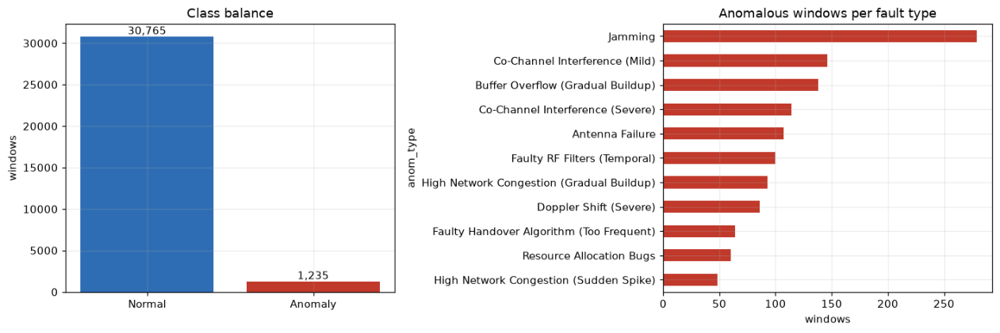

**Figure 1.** TelecomTS holds 30,765 Normal against 1,235 anomalous windows (left), and the anomalous windows per fault type range from 279 for Jamming down to 48 for Congestion-Sudden (right).

**Channel discriminability.** Per-channel means of normal and anomalous windows differ most for Estimated_UL_Buffer (+1,001 %), PRB_Utilization_UL (+272 %) and UL_NumberOfPackets (+265 %), and by only 4.8 % for RSRP. Per-channel statistics therefore carry real signal, while RSRP alone is a weak fault indicator. The dataset's affected-KPI metadata cannot be used as attribution ground truth, because it is populated only for Jamming (Figure 2); the KPI effects of the injected faults must be inferred from SHAP (Section 3.8).

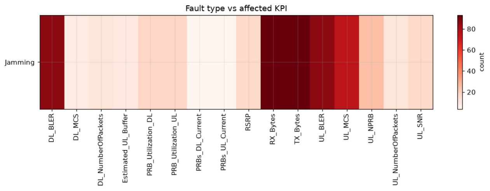

**Figure 2.** The affected-KPI metadata of TelecomTS is populated only for Jamming; its darkest cells are RX_Bytes and TX_Bytes, followed by DL_BLER, UL_BLER and UL_MCS.

**Context-label shortcuts.** The labels column holds operational context (zone, application, mobility, congestion). Windows labelled Mobility=Yes (927) and Congestion=Yes (2,781) contain no anomaly, so a classifier could learn that Mobility=Yes means Normal, and some fields derive from the anomaly labels. The labels column is therefore excluded from model inputs, and all statistics are recomputed from raw KPI values.

### 3.3 Data split: from window level to session level

**Window-level split.** The first prototype initially split individual windows, stratified by class (a window-level split). A near-duplicate analysis then found that 31.8 % of test windows had a training window with cosine similarity of 0.999 or more, a direct result of the 75 % window overlap. A first recording-level split was rejected because all anomalous windows fell in a subset of sessions and its test set received none.

**Session-level split.** The first prototype therefore moved to a session-level holdout with test sessions chosen so that every fault type appears in both partitions, which the final system keeps. Raneem Alnaghy recovered the sessions from the timestamps with nine gap thresholds between 1 s and 24 h; the count stabilises at 300 s (33 sessions of about 970 windows, against 32 at 3,600 s). This reconstruction of the 33 sessions underlies every final result. Whole sessions go to one partition, and the test sessions are {1, 3, 4, 13, 17}. Training has 28 sessions (25,688 windows, 935 faults) and test 5 sessions (6,312 windows, 300 faults, about 4.75 %). The retrieval index uses the same partition and holds training windows only. The Phase 1 report also gave a residual near-duplicate rate for this split, which the ML team's audit could not reproduce; the final results rely instead on the fact that no session appears in both partitions.

**What the sessions contain.** Under this reconstruction, 13 of the 33 sessions contain anomalies. A later analysis by the ML team (step 04) found that of the 28 training sessions, 18 are Normal-only, 9 are fault-only and only session 0 mixes both (3,007 Normal and 93 real Jamming windows). Every session with injected faults consists entirely of faults. The training faults therefore come from 10 sessions, two with Jamming. A held-out session is thus always an extrapolation to an unseen recording, and the number of fault sessions, not of fault windows, limits how precisely models can be compared.

### 3.4 Experimental protocol for the models

The first prototype tuned both models with StratifiedGroupKFold by session and reported Model 2 mainly by five-fold session-aware cross-validation. The ML team's audit found that its feature configuration had been chosen on the test set, and that the follow-up investigations reported with the feature ablation came from notebooks never executed in their submitted state.

Before any new experiment, the ML team therefore froze one protocol (step 01) for every later decision (Table 4), with selection on the 28 training sessions only and the Nadeau-Bengio corrected paired t-test [42] for comparisons. A gain counts as material if it reaches 0.03 macro-F1 or improves the cascade materially, and the held-out sessions are evaluated once per step as a post-hoc check, never for selection. Step 01 reproduced the real-only Model 2 baseline under this protocol (macro-F1 0.2908 ± 0.0902, rounded to 0.291), and all later gains are measured against it. The Phase 1 report's five-fold estimate (0.333 ± 0.076) came from a different protocol and is not used as a reference. As a last step, session-level bootstrap intervals and a power analysis quantified the uncertainty left by 10 fault sessions.

**Table 4.** Only the final protocol selects on the training sessions alone and has a comparison test and an adoption rule; the first prototype's protocol had none of these.

| Aspect | First prototype | Final system |
|---|---|---|
| Split | window-level stratified, then session-level holdout | session-level holdout, 33 sessions, 300 s gap |
| Data used for selection | feature configuration chosen on the test set (ML team's audit finding) | 28 training sessions only |
| Cross-validation | 5-fold, session-aware | StratifiedGroupKFold by session, 5 folds × 5 seeds |
| Comparison test | — | Nadeau-Bengio corrected paired t-test; Wilcoxon as a check |
| Adoption rule | — | p < 0.05, material gain, gain holds on the held-out sessions |
| Uncertainty | 95 % confidence interval (CI) on cross-validated macro-F1 | session-level bootstrap CIs and power analysis |

### 3.5 Feature engineering

**Scale-preserving principle.** No normalisation is applied at any stage, because normalising the raw series before extraction removes the absolute KPI level, which is itself diagnostic (Section 2.1). RQ1 tests this principle against normalised-feature and statistics-only baselines, and RQ3 asks which configuration gives the best trade-off between performance and cost.

**The first prototype's feature vector.** The first prototype computed four blocks per window (Table 5), 582 dimensions at the time of its ablation and 584 after the protocol block was rebuilt. The patchwise statistics keep absolute magnitude within each of 8 patches, following NuTime [17], and the difference statistics capture the rate of change. Its ablation compared Config A (statistics only, 64 dimensions), Config B (statistics and patchwise scale, 320) and Config C (the full vector); its algorithm comparison also used 64 features chosen from the full vector by SelectKBest. These are the first prototype's definitions; the ML team's report uses the same names for the final models without restating them.

**Table 5.** The first prototype's vector has four feature blocks (584 dimensions after the protocol fix); the final Model 1 keeps its 64 statistics, and the final Model 2 uses 496 features.

| Block or set | Dimensions | Content |
|---|---|---|
| Global statistics (Config A) | 64 (4 × 16) | mean, standard deviation, minimum and maximum per KPI, recomputed from raw values |
| Patchwise scale statistics | 256 (8 × 16 × 2) | mean and standard deviation per KPI in each of 8 equal patches |
| First-order differences | 256 (8 × 16 × 2) | mean and standard deviation of the difference signal per KPI and patch |
| Protocol encoding | 8 (4 × 2) | one-hot uplink (UL) and downlink (DL) protocol: TCP, UDP, None, EMPTY |
| Full vector after the protocol fix (Config C had 582 in the ablation) | 584 | all four blocks |
| Final Model 1 | 64 | Config A statistics, corrected parser |
| Final Model 2 | 496 | Config B + fast Fourier transform (FFT) + G1 G2 G3 (trend features), as named by the ML team; first prototype's parser |

**Status of the ablation.** On the window-level split with a Random Forest, Config A outperformed the larger configurations on both tasks, which the Phase 1 report attributed to too few training samples per feature for the larger vectors (Section 5.1). CatBoost with Config A then became the configuration of both first-prototype models. The leaky split and the ML team's audit findings weaken this evidence. Under the frozen protocol the ML team kept Config A for Model 1 and tested feature additions for each model separately (Sections 5.2 and 5.3), but did not repeat the three-configuration ablation.

**Defects and final feature sets.** The first prototype rebuilt its zero-filled protocol columns as eight one-hot columns after the ablation (582 to 584 dimensions). The ML team's audit found that the parser read "1.e-05" as 1 and −5, giving impossible block error rate (BLER) values in 492 training windows (1.9 %). Model 1 uses the corrected parser. Model 2 keeps the first prototype's parser, as the synthetic-data cache does; fixing the parser inside the generator gave a cross-validated macro-F1 of 0.385, a change the ML team judged negligible (Section 5.3, Table 16). Model 2's 496 features are Farida El Ghabary's recipe (Config B and FFT features) with the trend and co-movement features (the ML team's groups G1 to G3, called trend features below) added for the final system (Section 3.7). Co-movement features undefined for a flat KPI are stored as missing values.

### 3.6 Detection and classification models

**Why a two-stage cascade.** The first prototype evaluated a single 12-class classifier (Normal and the 11 faults) and rejected it for three reasons. First, the imbalance between Normal (30,765 windows) and the rarest fault (48) made joint training unstable. Second, detection and classification need different objectives (recall for detection, macro-F1 for classification) that one model cannot tune separately. Third, a detection threshold inside a joint model cannot be moved without retraining it.

**First algorithm search.** The first prototype compared LightGBM [19], Random Forest [21], XGBoost [20] and CatBoost [8] across the four feature configurations with a five-seed robustness check and selected CatBoost, with an Isolation Forest [23] as the unsupervised detection baseline. Model 1 used an 80/20 Normal/anomalous rebalance with an F2 objective, which weights recall above precision. Because the ML team's audit questioned the selection procedure, Section 5.1 gives only the resulting ranking, without the scores.

**Model 1 in the final system.** The ML team's audit found that the first prototype's Model 1 corrected the imbalance twice, by the rebalance and by balanced class weights, so it raised too many alarms. This defect and the parser defect were tested in a 2 × 2 design (step 03), and the adopted detector fixes both: 64 Config A features from correctly parsed signals, the 80/20 rebalance and no class weights, trained on 4,675 rows. Its threshold stays at 0.5, because the per-fold optimum ranged from 0.008 to 0.927 (step 02), so no tuned threshold would transfer to a new session. Targeted alternatives (step 10a), from level-jitter augmentation to shape-based detectors, did not meet the adoption rule (Section 5.2).

**Model 2 in the final system.** Nine algorithms were compared on real data only (step 07), from tree ensembles such as ExtraTrees [22] and CatBoost on catch22 features [27] to the time-series classifiers QUANT [24], MiniRocket [25] and Hydra [26] (Section 5.1). With synthetic data added (step 08), LightGBM scored above Farida El Ghabary's CatBoost recipe but not significantly (p = 0.37), so the algorithm was not switched. The final candidates, including soft votes of CatBoost and QUANT, were also measured on the held-out sessions (step 09c, Section 5.3). The final Model 2 is CatBoost trained on 935 real and 4,250 synthetic (v3) windows (5,185 rows).

**Reject option.** The first prototype revealed an implicit catch-all class: Model 2 cannot answer "none of the above", and 82.2 % of the detector's false alarms were labelled CCI-Mild. Raneem Alnaghy's reject option, an extra Normal class for Model 2, was tested against a random Normal class and a probability threshold (steps 10 and 10c). Section 5.4 gives its design and results; the final pipeline has no reject class.

**Confidence.** The Layer 2 confidence is uncalibrated: an isotonic calibration [43] was tested and removed because it erased the ranking of Model 1's scores (Section 5.4).

### 3.7 Synthetic data augmentation

In the first prototype, SMOTE (synthetic minority over-sampling technique) [44] gave Model 2 a single-split gain that cross-validation did not confirm. Farida El Ghabary's v3 generator, developed afterwards, builds synthetic fault windows by copying fault effects from the real fault sessions onto Normal-session backgrounds. The generator's first evaluation, by its author, found its gain consistent but not significant, so the ML team audited the generator code (`src/v3.py`) before relying on it. Donors and hosts come only from the 28 training sessions, and generation is nested inside cross-validation: effects, references, bounds and hosts are rebuilt from each fold's training sessions, and validation uses real windows only. The generator fixes its seeds, enforces physical limits and real-data bounds, and applies a Wilcoxon test (α = 0.001) as a statistical gate. A 25-fold cache (step 09z) reproduces inline generation exactly (maximum difference 0.0), and the v3 recipe's final model was reproduced in 25 of 25 folds (0.3743).

Under the frozen protocol the ML team then compared v3 with real-only training (step 06) and tested further changes, from excluding Congestion-Gradual and Buffer Overflow from augmentation to adding the trend features. Section 5.3 gives the results (Table 16) and the three limits the ML team recorded, among them that every synthetic fault copies effects from the same 10 fault sessions.

### 3.8 SHAP attribution

SHAP [40] assigns each feature an additive contribution to one prediction. The first prototype applied SHAP TreeExplainer to both CatBoost models; in the final system the three strongest SHAP attributions per alarm feed the explanation layer and the dashboard. Because the injected faults have no affected-KPI ground truth, the first prototype compared Model 2's SHAP ranking with the KPI effects expected from the specifications. Section 4.3 describes how the final export chooses the SHAP source and which features it keeps out of the top three. Each entry stores the magnitude |SHAP|, its effect on the predicted class (towards or away from it) and the KPI's direction against its normal mean (`feature_vs_normal`). The first prompts printed the magnitude as "SHAP=+x", presenting every feature as support. Yet 97 of the 1,146 top-three entries push away from the predicted class, so the prompts now state all three in words.

### 3.9 Standards alignment method

The alignment table maps each fault class to the 3GPP specification that governs it and to the O-RAN component [4] to act on. The predicted fault's row goes into the deployed prompt, and its references are what the citation validator accepts.

**First construction.** A go/no-go check required evidence in the GSMA knowledge graphs for at least 7 of the 10 injected fault types. Each row was built in three stages. Keyword search of the telecom-kg-rel19 graph [2] gave a candidate 3GPP clause, and keyword search of the O-RAN specification graph [3] (15,103 nodes and 5,954 chunk nodes in the extracted evidence set) gave a candidate O-RAN component. Both were then verified against the primary specification text, recording document identifier, release, clause and evidence span. Separating direct from mechanism-level support raised coverage to 10 of 10 (6 direct, 4 mechanism-level). Jamming, a physical radio-frequency attack, was given no standard. Verification and the first prototype's audit also corrected the Doppler Shift row from TS 38.901 to TR 38.901 [15], a Technical Report. A live Neo4j/Cypher query path was set aside, because a static, validated table keeps the evidence auditable and lets Track C isolate the table's effect.

**Version 1.2.** Rodina Khallaf's revision, the "3GPP and O-RAN alignment matrix, v1.2", maps the classes to 3GPP Release 19 and records for each its domain, onset profile, causal mechanism and affected KPIs. Its author marks Jamming "Dataset Validated": a real over-the-air condition, evaluated against operational ticket logs, with no 3GPP clause or O-RAN target. The one change of primary specification moves Faulty Handover from TS 38.133 §4.3.5 [45] to TS 38.331 §5.5.4.4 and §5.5.4.1 [13]. Section 4.4 gives the final table (11 rows, 10 with a 3GPP reference) in Table 9.

### 3.10 Retrieval and explanation generation

The explanation layer (Ahmed Al Shobaki) works in four steps. It indexes the KPI narratives of past incidents offline and retrieves similar incidents of the predicted fault type for each alarm. It then prompts the LLM with the alarm's evidence, the incidents and the fault's alignment row, and normalises and validates the cited standard. Section 4.5 describes the implementation.

**Retrieval design.** The first prototype indexed the tickets and question-and-answer traces of the 935 anomalous training windows and put the predicted label in the query. A later measurement of the corpus showed that the ticket takes only 11 distinct values across these windows, one template per class. The root-cause answer in every question-and-answer trace is the class name, so ticket retrieval returned the label in another form. The final index therefore holds each training window's KPI narrative, the only window-specific text, embedded with all-MiniLM-L6-v2, a Sentence-BERT model with 384-dimensional embeddings [29, 30]. The vectors sit in a cosine-space ChromaDB collection [31] with the fault type as metadata; an early index had used L2 distance while computing similarity as one minus the distance. Narratives exceed the model's 256-token input, and truncation was kept because averaging the embeddings of all paragraphs retrieved far worse (Section 5.6). The query is built from the alarm alone (top SHAP channels, their direction against the normal mean, uplink and downlink KPI means). A metadata filter restricts results to the predicted fault type, because text evidence alone identifies the true class only modestly above the majority-class share (Section 5.6). The top three of five retrieved incidents reach the LLM, and a top similarity below 0.35 raises a low-confidence flag, as in the first prototype.

**Prompt conditions.** The three conditions differ only in the context they add (Table 6). The header gives the predicted fault, the confidence and one line per SHAP feature, such as "RSRP: below normal (|SHAP|=0.42, toward predicted class)". One instruction block, identical in all conditions, asks for five JavaScript Object Notation (JSON) fields (root cause, 3GPP reference, O-RAN component, recommended action, reasoning trace) and gives no example standard number, since an example would hint at the answer. An earlier version had given only C3 a "use TR …, e.g. TR 38.901" hint.

**Table 6.** In the Track C prompts, C2 adds retrieved incidents to C1, and C3, the deployed configuration, also adds the evidence block and the alignment row. For Jamming, which has no 3GPP reference, the standards block states that no 3GPP clause applies.

| Block | C1 | C2 | C3 (deployed) |
|---|---|---|---|
| Header: fault, confidence, SHAP lines | yes | yes | yes |
| Per-window evidence block | no | no | yes |
| Three retrieved incidents (KPI narratives) | no | yes | yes |
| Alignment row: standard, clause, O-RAN component | no | no | yes |
| Shared instruction block (five JSON fields) | yes | yes | yes |

**Per-window evidence block.** C3 adds a short block built from the alarm's root-cause analysis (RCA) evidence record (289 records, one per non-Jamming alarm): SHAP features, observed KPI means and the start of the causal mechanism. The first prototype's audit had found these records reaching the dashboard but not the prompt, and wired them into C3. The record's standards text is left out, because some records still carry the older Handover standard (TS 38.133) and the alignment table must be the only source of standards in the prompt. The record's "evidence status" is left out as well, because it was derived from labelled windows that include the test split. Before the final Track C run the team revised the records to match the Layer 2 SHAP top three; the revision changed the C3 evidence block of 61 of the 289 records.

**Generation and validation.** The deployed backend is Gemini 3.5 Flash Lite [7] at temperature 0.1 with JSON output; the first prototype was developed with Llama 3.1 8B through Ollama. The validator accepts the first citation in the reply, normalised to a TS/TR number, only if it is among the valid references of the alarm's fault, a lookup the first prototype's audit made fault-specific. Jamming, the only fault type without a 3GPP reference, can never have a valid citation (an earlier version accepted any fault's primary standard). A template answer, the fallback produced after failed LLM calls, is always invalid, and clause numbers are not validated.

### 3.11 Evaluation design

The first prototype planned Track A for detection, Track B for explanation quality (with citation faithfulness and a TeleQnA probe) and Track C for an end-to-end ablation of the explanation layer. In the final design Track B is an LLM-judge evaluation of explanation quality (G-Eval), Track C the citation ablation, and the TeleQnA probe became Track D. Table 7 gives each track's question, sample and metrics.

**Track A: detection and classification.** The detector is evaluated on the five held-out sessions at the natural rate, against the first prototype's detector. The Phase 1 report's headline detector F1 had been computed on a rebalanced subset of 1,000 windows, which the final evaluation does not repeat. Model 2 gains are measured against the real-only baseline (0.291), and a family-level accuracy treats Congestion-Gradual, Buffer Overflow and Congestion-Sudden as one congestion family. Published results are cited for context only (Section 5.5).

**Track B: explanation quality (G-Eval).** Rodina Khallaf's Track B applies an LLM-as-judge protocol based on G-Eval [41] to KPI-RAG explanations of 30 fault windows. Each explanation is scored against a structured ground-truth reference on citation validity, fault specificity, actionability and causal soundness, each on a 1 to 5 integer scale with a rubric calibrated against expert-written explanations; the composite is their unweighted mean. Track B is reported on its own and is not combined with the Track C counts.

**Track C: citation ablation.** Ahmed Al Shobaki's Track C runs the full system under C1, C2 and C3 on identical windows. The first prototype drew 3 test windows for each fault with a 3GPP reference (seed 42) and scored validity against the predicted fault's row. The later audit of the ablation runs found that sampling windows by predicted label mixed Normal and misclassified windows into the sample. The final design samples three windows per true fault type (seed 42) and counts a citation as correct only if it is valid for the true fault. A misclassified window that receives the wrong row, or a missed window, therefore counts as incorrect. Validity against the predicted row, the closest analogue of the first prototype's measure, is also recorded. Two rules that need no LLM are scored on the same windows: always citing the standard most often correct (TS 38.141-1 [10]) and citing the predicted fault's row. Wilson 95 % intervals [46] and exact McNemar tests [47] describe effect sizes and are not read as significance tests. The O4 target of at least 70 % correct citations is checked on the cited specification number, since clause numbers are not validated. A separate retrieval experiment compares four designs on the 266 detected test faults by precision@1 and @5, against the majority-class share and the classifier's label accuracy. The designs are tickets with and without the label in the query, KPI narratives, and narratives embedded by averaging all paragraphs.

**Track D: TeleQnA.** Rodina Khallaf's Track D characterises the knowledge scope of the retrieval pipeline on the TeleQnA multiple-choice benchmark [33], using the Standards specifications, Standards overview and Lexicon categories; the two research categories are excluded. The LLM answers with no context and with KPI-RAG, whose retriever queries a ChromaDB knowledge base of 935 fault-diagnosis telemetry tickets and prepends the top-k chunks. A coverage audit marks a question as supported when its top similarity reaches τ = 0.50, and a post-hoc confidence gate on the stored answers keeps the KPI-RAG answer only when the top similarity reaches τ (swept from 0.20 to 0.60). Track D therefore evaluates retrieval over this ticket corpus, not the deployed retrieval over per-window narratives.

**Table 7.** The four evaluation tracks of the final system answer different questions on different samples; the last column states what each one does not measure.

| Track (owner) | Question | Sample | Metrics | Does not measure |
|---|---|---|---|---|
| A Detection and classification (Farida El Ghabary, Raneem Alnaghy) | How well does the cascade detect and classify faults in unseen sessions? | 25 session folds; 5 held-out sessions (6,312 windows, 300 faults) | Model 1: precision, recall, F1, PR-AUC (area under the precision-recall curve), false alarms; Model 2: macro-F1, accuracy; cascade: exact and family-level accuracy, catch-all share | performance beyond one testbed and 10 training sessions with faults |
| B Explanation quality, G-Eval (Rodina Khallaf) | How specific, actionable and causally sound are the explanations? | 30 explanations, 3 per fault type, 10 types | G-Eval scores (1-5) on four dimensions; composite; judge-rated citation validity | agreement with human raters |
| C Citation ablation (Ahmed Al Shobaki) | How much does standards grounding improve citation correctness, and how much error comes from upstream? | 30 test windows, 3 per true fault, 10 faults with a 3GPP reference | correct for the true fault (n = 30); correct when classified correctly; valid against the predicted row; Wilson 95 % confidence interval (CI); exact McNemar | clause numbers; the LLM's own knowledge in C3; quality of the explanation text |
| D TeleQnA (Rodina Khallaf) | What is the knowledge scope of the retrieval pipeline outside fault diagnosis? | 600 TeleQnA questions, 200 per category | coverage at τ = 0.50; accuracy without and with retrieved context; accuracy under a post-hoc gate | the deployed narrative retrieval; fault diagnosis |

### 3.12 Tools and resources

The ML layers use Python with scikit-learn [48], CatBoost, LightGBM, XGBoost, aeon and SHAP, in numbered scripts with seeded randomness and pinned versions. The explanation layer uses Python 3.11 managed with uv, sentence-transformers, ChromaDB 1.5 (HNSW search [32]), the google-genai, groq and openai clients, pydantic, Streamlit 1.61 [9] and pytest, with its parameters in `configs/config.yaml`. CatBoost and SHAP need no graphics processing unit (GPU). LLM development for the first prototype used the Queen's University high-performance computing (HPC) cluster (Frontenac); the final evaluation and the public demonstration on Streamlit Community Cloud call Gemini on a free-tier quota. The data resources are TelecomTS (MIT licence), the GSMA telecom-kg-rel19 and O-RAN specification knowledge graphs (CC BY-NC 4.0), TeleQnA and the 3GPP Release 19 specifications.

Chapter 4 describes how these methods are implemented in the final system.


## 4. Design and Implementation

### 4.1 System architecture

KPI-RAG is a three-layer pipeline that turns a window of 5G KPI measurements into a fault diagnosis grounded in 3GPP standards. The first prototype (September 2026) drew it as five boxes in a row: TelecomTS data, Layer 1 (preprocessing and feature engineering), Layer 2 (detection, classification and SHAP), Layer 3 (retrieval, alignment table and LLM explanation) and a dashboard. When the binary detector returned Normal, the pipeline stopped at Layer 2 with a "No anomaly detected" message. The final system keeps the layers and the stop rule; most components inside them were rebuilt.

Figure 3 shows the system as delivered. The top row holds the inputs: TelecomTS [1], the session split and the synthetic training windows (v3), which come from training sessions only. Layer 1 computes one feature set per model, and Layer 2 runs the detector, then the 11-class classifier, and exports each alarm's top three SHAP features. In Layer 3 the two shaded boxes do the grounding: the fault's row of the alignment table (matrix v1.2) with a per-window evidence block, and the LLM, whose answer passes through the citation validator. The dashboard and the evaluation tracks consume the result. Following the division of work in Section 3.1, the ML team owns Layers 1 and 2, Rodina Khallaf the alignment table, and Ahmed Al Shobaki the explanation layer, the dashboard and the deployment.

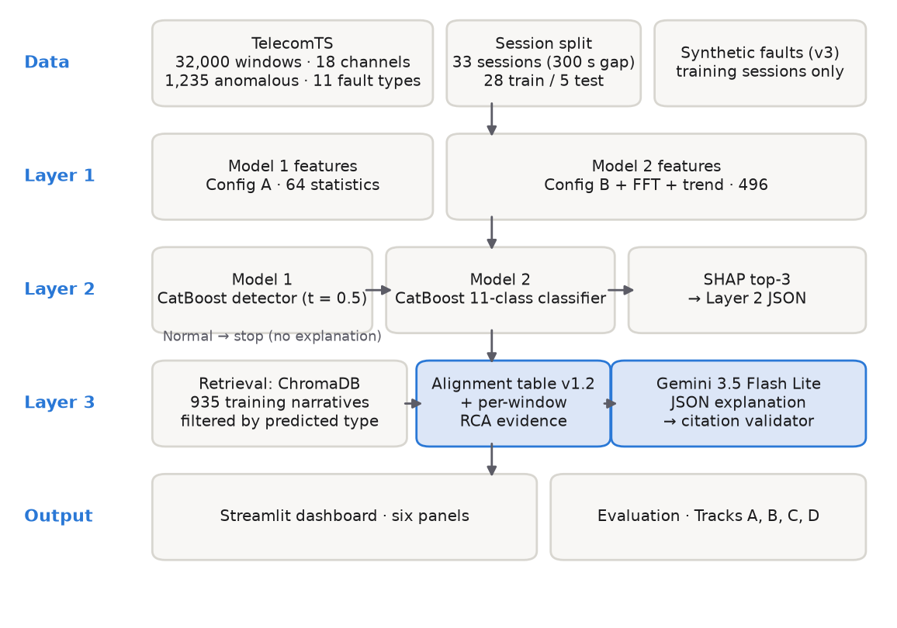

**Figure 3.** The final KPI-RAG system runs from the data inputs through the three layers to the dashboard and the evaluation tracks; Normal windows stop at the detector, and the shaded Layer 3 boxes hold the standards grounding and the citation check.

**Data flow.** Layers 1 and 2 run as a batch pipeline (`scripts/11_final_pipeline.py`) that trains the final models on all 28 training sessions and writes one Layer 2 record for each of the 6,312 test windows. Layer 3 reads that file, or an uploaded record in the same schema, and explains one alarm at a time against an index built offline from the 935 anomalous training windows. Ground truth travels with each record but is read only by the evaluation scripts, never by the prompt.

**Inter-layer JSON contract.** The ML team delivered the final cascade with the first prototype's Layer 2 JSON schema unchanged. Each record carries `window_index`, `anomaly_type`, `confidence`, `shap_top3` and `signal_statistics`, and the validation step found 0 invalid field values over the 6,312 records: every channel is one of the 16 numerical KPIs, and `shap_effect` and `feature_vs_normal` take only the values the first prototype defined. On the Layer 3 side each record is parsed into a pydantic model, `ClassifierOutput` (`src/schema.py`), so a malformed input fails at the boundary instead of deep inside a prompt. It requires one of the 11 known fault types, a confidence between 0 and 1, exactly three SHAP entries (channel, value, feature name, direction against the normal mean and effect on the class) and the window statistics. The value is the magnitude |SHAP|, with the sign kept in another field, and the older field name `predicted_fault_type` is still accepted as an alias.

### 4.2 Layer 1: preprocessing and features

Layer 1 keeps the rule, set in the first prototype, that no normalisation is applied at any stage, because absolute KPI levels are diagnostic (Section 3.5). The labels column is excluded, and all statistics are recomputed from raw KPI values. The two final models use different feature sets and different parsers (Table 5). Model 1 uses the 64 Config A statistics computed from correctly parsed signals. Model 2 uses 496 features (Config B + FFT + G1 G2 G3) computed with the first prototype's parser (Section 3.5). Both parsers are recorded in `feature_spec.json`. Co-movement features that are undefined for a flat KPI are stored as NaN (not a number), which CatBoost treats as missing.

The session split is also a Layer 1 output. Raneem Alnaghy's 33 sessions (300 s gap) give the test sessions {1, 3, 4, 13, 17} and 28 training sessions (Section 3.3). The indices are stored as `.npy` files (`data/indices/*_idx_sessionsplit.npy`) and are shared by both models and by the retrieval index, so no test window is indexed. Farida El Ghabary's synthetic windows (v3) take donors and hosts only from the 28 training sessions and are regenerated inside each cross-validation fold.

### 4.3 Layer 2: the final cascade

The final system keeps the cascade of the first prototype, a binary CatBoost detector [8] followed by an 11-class CatBoost fault classifier, with SHAP attributions [40] for every alarm (Section 3.6 gives the reasons for preferring it to a single 12-class model). The models inside it were rebuilt. The final Model 1 fixes the two defects of the first detector (Section 3.6): it keeps the 80/20 rebalance without class weights and uses the corrected parser. Model 2 is the v3 recipe of Farida El Ghabary (CatBoost with v3 synthetic data, Config B and FFT) plus the trend features, with no reject class (Sections 3.6 and 5.4). Table 8 lists what the final pipeline (`scripts/11_final_pipeline.py` with `src/pipeline.py`) writes to `results/final/`.

**Table 8.** The final Layer 2 pipeline, trained on all 28 training sessions, writes two models, their feature specification, the Layer 2 output and a validation report.

| Artefact | Content |
|---|---|
| `model1.cbm` | CatBoost detector, 64 Config A features (correct parser), 80/20 rebalance, no class weights, t = 0.5; trained on 4,675 rows |
| `model2.cbm` | CatBoost 11-class classifier, 496 features (Config B + FFT + G1 G2 G3), real 935 + 4,250 v3 synthetic windows (5,185 rows) |
| `feature_spec.json`, `normal_means.json` | feature names and order, parser per model, hyper-parameters, library versions; reference means for `feature_vs_normal` |
| `layer2_output_sessionsplit_phase2.json` | 6,312 test windows, exact schema of the first prototype |
| `validation.json` | schema checks, cascade counts, side-by-side comparison with the first prototype, reload test |

The reload test confirms that the saved models reproduce every prediction. On the test sessions the cascade raises 382 alarms (266 true faults, 116 false alarms) and labels 5,930 windows Normal; Chapter 5 analyses these results.

**Confidence.** `confidence` is the raw Model 1 probability for windows labelled Normal and Model 2's probability for fault windows. It is not calibrated, because the isotonic calibration that was tested erased the ranking of the scores and was removed (Section 5.4).

**Idle-link note.** In session 0 an idle link (no traffic, no allocated physical resource blocks (PRBs)) looks like a link blocked by jamming. A flagged window whose only fault evidence is "no traffic" by fixed thresholds (transmitted bytes (TX) < 1 kB per sample, PRB utilisation < 1 %, fewer than 1 packet per sample) therefore carries `note: "idle_link_ambiguous"` in its `shap_top3` entries. The note changes no label; Section 5.4 reports how many windows it marks.

**SHAP export.** The first prototype's export chose the SHAP source by the ground-truth label, which is not available at inference; the final export chooses it from the models' own output. The three cross-KPI co-movement features (`n_shift_*`, `onset_*`, `diff_*`) are excluded from `shap_top3`, and NaN features are never written there, so the channel field always names a KPI, as the alignment check expects.

### 4.4 Layer 3: the alignment table (matrix v1.2)

Rodina Khallaf's final version of the table (Section 3.9) is the "3GPP and O-RAN 5G/NR Anomaly Alignment Matrix (v1.2)", called the alignment table in this report. Table 9 reproduces it with the class and KPI names of the original: 11 rows, 10 with a 3GPP Release 19 reference [10, 11, 12, 13, 14, 15] and an O-RAN component [4], while Jamming has neither. Its author reports that the 10 injected fault classes were verified against Release 19, and that the affected-KPI column reflects Layer 2 mean absolute SHAP rankings across the evaluated windows.

**Table 9.** The alignment table (matrix v1.2, Rodina Khallaf) maps each of the 11 TelecomTS fault classes to its 3GPP Release 19 specification and O-RAN target; the affected KPIs reflect Layer 2 mean absolute SHAP contribution rankings across evaluated time windows.

| ID | TelecomTS Fault | Domain | Onset Profile | Affected KPIs (SHAP Top 3) | 3GPP Specification | O-RAN Target | Validation |
| --- | --- | --- | --- | --- | --- | --- | --- |
| #1 | Antenna Failure | Hardware | Gradual | `DL_MCS`, `RSRP`, `DL_BLER` | TS 38.141-1 §4.2.1 & §7.2 | O-RU | Confirmed |
| #2 | Buffer Overflow | Software/Infra | Gradual | `PRB_Util_UL`, `RSRP`, `UL_Pkts` | TS 38.321 §6.1.3.1 & §5.4.5 | O-DU | Confirmed |
| #3 | CCI (Mild) | Infrastructure | Instantaneous | `UL_SNR`, `RSRP`, `UL_Pkts` | TS 38.141-1 §7.8 | O-RU | Confirmed |
| #4 | CCI (Severe) | Infrastructure | Instantaneous | `UL_SNR`, `DL_BLER`, `RSRP` | TS 38.141-1 §7.8 + TS 38.104 §4.9 | O-RU | Confirmed |
| #5 | Doppler Shift (Severe) | Environment | Gradual | `DL_MCS`, `RSRP`, `UL_NPRB` | TR 38.901 §7.6.6 & §7.6.10 | O-DU / O-RU | Confirmed |
| #6 | Faulty Handover Algorithm | Software | Gradual | `RSRP`, `UL_Pkts`, `UL_MCS` | TS 38.331 §5.5.4.4 & §5.5.4.1 | Near-RT RIC | Confirmed |
| #7 | Faulty RF Filters (Temporal) | Hardware | Gradual | `RSRP`, `UL_SNR`, `PRBs_UL_Curr` | TS 38.141-1 §7.5, §7.6 + TS 38.104 §6.6 | O-RU | Confirmed |
| #8 | High Congestion (Gradual) | Usage | Gradual | `RSRP`, `UL_SNR`, `PRB_Util_UL` | TS 28.552 §5.1.1.2.1 & §5.1.1.2.2 | O-DU | Confirmed |
| #9 | High Congestion (Spike) | Usage | Instantaneous | `UL_SNR`, `DL_BLER`, `UL_NPRB` | TS 28.552 §5.1.1.2.1 & §5.1.1.2.2 | O-DU | Confirmed |
| #10 | Resource Allocation Bugs | Software | Gradual | `PRBs_DL_Curr`, `UL_NPRB`, `UL_SNR` | TS 38.321 §5.4.3.1.3 | O-DU / RIC | Confirmed |
| #11 | Jamming (OTA Real-world) | Physical RF | Alternating | `RSRP`, `TX_Bytes`, `DL_BLER` | N/A (Real Over-The-Air) | N/A (External RF) | Dataset Validated |

**Causal mechanisms.** Each row rests on a physical mechanism that links the fault to its KPI signature. A degraded antenna, for example, lowers RSRP at the O-RU, and link adaptation then lowers `DL_MCS` to hold `DL_BLER` (#1); high user equipment (UE) velocity causes a Doppler shift that corrupts channel estimation, so the scheduler falls back to a low `DL_MCS` (#5). Rodina Khallaf arranges the mechanisms in five functional groups (radio front end, MAC scheduler and queueing, interference and over-the-air RF, environment and mobility, traffic congestion), and Appendix A gives the full analysis.

**From table to code.** Section 3.9 describes how the first table was built and what version 1.2 changed. The table reaches the code as `data/alignment_table.json`, with each fault's valid TS/TR numbers, clause text and O-RAN component. A fault's valid references are the specifications in its row, so CCI-Severe and RF Filters accept TS 38.141-1 or TS 38.104. The move of Faulty Handover from TS 38.133 to TS 38.331 had a side effect: some root-cause analysis (RCA) evidence records still carry the standard of the earlier table version (Handover TS 38.133). This is one reason the alignment table is the only source of standards in the prompt (Section 3.10).

### 4.5 Layer 3: retrieval, evidence block, LLM explanation and citation validation

The explanation layer (Ahmed Al Shobaki) takes one Layer 2 alarm and returns a structured explanation with a checked citation. It implements the design of Section 3.10 in the modules below.

**Indexing** (`src/data_loader.py`, `src/kg_indexer.py`, `scripts/build_index.py`). The loader reads the TelecomTS files in sorted order and keeps the anomalous records. `apply_train_split()` keeps only training windows and raises an error if the split file is missing, and `verify_ticket_order()` checks each record's label against the ground truth for its position, since raw records carry no identifier. The indexer embeds each KPI narrative with `all-MiniLM-L6-v2` [29, 30] into the cosine-space ChromaDB [31] collection `telecomts_descriptions`, with its fault type as metadata, and adds only ids it has not seen. `build_index.py --rebuild` recreates the collection and refuses to clear it when no raw records were loaded.

**Retrieval** (`src/rag_query.py`). `build_query()` builds the label-free query of Section 3.10 from the alarm, and `query_from_classifier_output()` runs it with the predicted-type metadata filter. It returns the incidents with their similarity, computed as one minus the cosine distance, and a low-confidence flag.

**Evidence block** (`src/rca_loader.py`). The RCA loader indexes the 289 RCA evidence records (all non-Jamming alarms) by window and formats an alarm's record into the evidence block of Section 3.10, leaving out the record's standards text and "evidence status". It injects the block only when the record matches the alarm's window and fault.

**Prompt and generation** (`src/llm_explainer.py`). The explainer assembles the prompts from the shared parts of Table 6 (template in Appendix E), calls the configured backend through a shared rate limiter, parses and normalises the reply and validates the citation. `explain()` is the deployed path (C3), and `explain_condition()` exposes all three conditions for the ablation. Gemini 3.5 Flash Lite [7] is the deployed backend, with Groq and Ollama behind the same interface.

**Parsing and validation.** The parser accepts bare or fenced JSON, rejects missing or non-string fields and normalises the first citation, so "TS38.331", "ts 38.331" and "3GPP TS 38.331 §5.5.4.4" all become `TS 38.331`. The validator accepts a reference only if it matches the TS/TR format and is listed for the alarm's fault in `data/alignment_table.json`.

**Data contract and scripts.** Two further pydantic models carry the output: `RetrievedTicket` (id, narrative, fault type, similarity) and `LLMExplanation` (the five fields plus `reference_valid`, `template_generated` and `fallback_reason`). With these fields the dashboard and the evaluation can tell a model answer from a template and see why the template was used. `scripts/run_eval_track_c.py` samples by ground truth, runs the three conditions and the two answer rules that need no LLM. It refuses to overwrite a run without `--force`, and with `--summarise-only` it rescores saved explanations without LLM calls. `run_eval_track_a.py` recomputes the classifier's metrics from the Layer 2 file, which confirmed that the file the explanation layer consumes matches the ML team's validation counts.

**Error handling.** Evaluation and the public demonstration both run on a free-tier quota, so the client separates errors worth retrying from errors a retry cannot fix (Table 10). The rate limiter introduced in the first prototype (Section 5.10) is kept, and the final client adds the non-retryable class, so a missing key or a broken request stops the run with a clear cause.

**Table 10.** The LLM client (`_run_with_retry()` and `_is_non_retryable()` in `src/llm_explainer.py`) retries rate limits and transient errors and stops at once on errors that a retry cannot fix.

| Situation | Behaviour |
| --- | --- |
| Every call | at least 2 s after the previous one, for all backends |
| Rate limit (429) | wait for the server's Retry-After, or back off exponentially from 5 s with jitter; give up if the server asks for more than 60 s, as with a daily quota |
| Configuration or client error (missing key, 400/401/403/404) | stop at once; retrying the same request cannot succeed |
| Malformed or incomplete JSON | retry |
| Other transient errors (timeouts, 5xx) | retry after 1, 2, 4 ... s, at most 10 s |
| Three attempts used | template explanation with its cause in `fallback_reason`, always counted as invalid |

Table 11 collects the main design decisions of the explanation layer with the reason for each.

**Table 11.** Each main design decision of the explanation layer has a stated reason; several of them fix cases in which an earlier version produced plausible output for the wrong reason.

| Decision | Choice | Reason |
| --- | --- | --- |
| Retrieval documents | per-window KPI narratives | ticket text is one template per class (Section 3.10) |
| Fault label | metadata filter, not part of the query | text alone cannot identify the class; a label in the query only echoes it |
| Index metric | cosine space, rebuilt from scratch | an early L2 index made "1 minus distance" a meaningless similarity |
| Standards source | alignment table only | a second source (RCA records) produced conflicting references after the table was updated |
| Instructions | one block for all conditions, no example standards | conditions must differ only in context, and an example hints at the answer |
| Ablation sampling | by true fault, scored against the true row | separates grounding from classifier errors |
| Failure handling | fail closed; labelled template | a missing split or a broken key should stop the run instead of producing plausible output |

### 4.6 Dashboard and deployment

The user interface is a Streamlit [9] dashboard on Streamlit Community Cloud (https://kpi-rag-group15.streamlit.app/), deployed from branch `master` of the project repository. Hugging Face Spaces was the first target but was abandoned after a policy change required a paid PRO subscription.

The dashboard has had six panels since the first prototype. In that version the third panel plotted the top three channels over the 128 steps and the sources panel listed retrieved ticket IDs. The final version (`dashboard/app.py`, components in `dashboard/components/`) shows one alarm at a time. Its first three panels are Detection (predicted fault and confidence), SHAP (top contributing KPIs) and KPI window statistics. The other three are Explanation, Sources and RCA evidence. Explanation gives the root cause, action and reasoning, with a citation badge and the cause when a template was used. Sources lists the retrieved incidents with their similarity, flagged when weakly similar, and RCA evidence shows the fault's standard and O-RAN component and the evidence injected into the prompt.

The input is a built-in example, an uploaded `ClassifierOutput` JSON or one of the 382 test alarms, filtered by fault type. An earlier version listed the 935 training windows, whose own narratives were in the index. Two defects were fixed and covered by tests: a class with a single alarm (Congestion-Sudden) crashed the window slider, and a second upload showed the first file's explanation. Uploads are now keyed by content, so a new file never shows an old explanation. The dashboard runs retrieval and the LLM explanation live on stored or uploaded classifier outputs; the classifier itself does not run in the app. Figure 4 shows one test alarm after its explanation has been generated, with every panel populated.

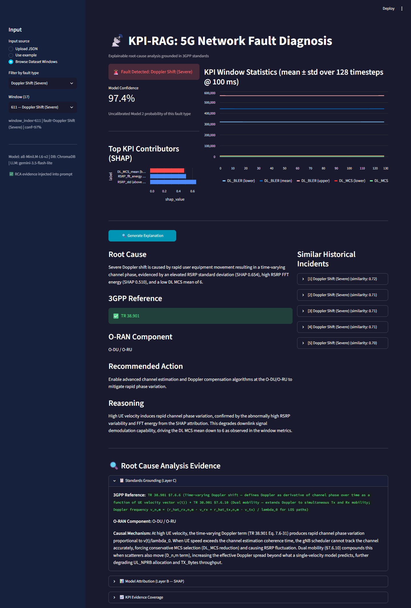

**Figure 4.** The dashboard explains test window 611, classified as Doppler Shift with an uncalibrated Model 2 probability of 97.4 %. The explanation cites TR 38.901, which passes the citation check (green badge), and names the O-DU / O-RU. The five retrieved incidents are of the same fault type, with similarities of 0.70 to 0.72, and the sidebar confirms that the per-window RCA evidence was injected into the prompt.

In the first prototype, caching the heavy resources (embedding model, ChromaDB collection, RCA store) kept the application at about 430 MB, within the free tier's 1 GB memory limit. The final packaging locks dependencies with uv and a PyTorch build that runs on the central processing unit (CPU) only, because the default Linux wheel pulled about 2 GB of CUDA libraries although no GPU is used. It exports `requirements.txt` from the same lock for Streamlit Community Cloud. The source folders install as a package, so scripts run without `PYTHONPATH`, and the split indices and the 17 MB index are committed.

### 4.7 Software quality: tests, configuration and reproducibility

The first prototype ended with 118 tests in 16 modules, all passing (Section 5.10). The final suite has 210 tests in 29 modules (21 unit and 8 integration modules). They cover the data contract, index building, retrieval, prompt construction per condition, parsing and citation validation, the retry policy with mocked rate limits and client errors, Track C sampling and scoring, every dashboard panel and a headless run of the whole app. The inventory (Appendix J) also includes the modules `test_phase2_data`, `test_phase2_models` and `test_phase2_pipeline` (53 tests). A fixture restores the committed index after tests that modify it. On the current code 207 tests pass and 3 are skipped because they need a Groq application programming interface (API) key.

Retrieval, LLM, retry and evaluation parameters are read from `configs/config.yaml` (Appendix H), and Track C sampling uses seed 42. On the ML side all randomness is seeded, `requirements.txt` pins the versions and `feature_spec.json` records each model's parser, hyper-parameters and library versions. Four reproducibility defects found after the first prototype were fixed at their source. The CPU-only lock and the package install of Section 4.6 remove the CUDA download and the need for `PYTHONPATH`, the split indices are now committed, and `build_index.py` no longer empties the committed index when raw data is missing. A clean clone runs the tests and the dashboard after `uv sync` (Appendix I). Chapter 5 evaluates this final system against the first prototype and the published results.


## 5. Results and Evaluation

Where the first prototype (September 2026) produced a result, a section starts from it and ends with the final system. All final results use the session-level split of Section 3.3, and the five test sessions {1, 3, 4, 13, 17} were used only as a post-hoc check, never for selection.

### 5.1 Feature-engineering ablation and model selection

The first prototype tested the hypothesis that a 582-dimensional scale-preserving feature vector (global statistics, patchwise scale statistics, first-order differences and a categorical encoding) would outperform a statistics-only baseline. Its early ablation compared three configurations with a Random Forest [21] under a window-level split. The first prototype itself replaced that split with the session-level split before reporting its final results. Adjacent windows overlap by 75 %, and under the window-level split 31.8 % of test windows had a training window with a cosine similarity of at least 0.999 (Section 3.3). The values in Table 12 therefore show how the configurations ranked under a leaky split. They are not performance estimates, and none of them is a final result.

**Table 12.** In the first prototype's feature-configuration ablation, Config A (statistics only) scored highest on both tasks (window-level split, Random Forest; superseded protocol, reported as history only).

| Config | Dims | Binary F1 | Fault macro-F1 | Samples per feature |
|---|---|---|---|---|
| A: Statistics only | 64 | 0.981 | 0.945 | 15.4 |
| B: Statistics + patchwise scale | 320 | 0.975 | 0.894 | 3.1 |
| C: Full vector | 582 | 0.964 | 0.883 | 1.7 |

The Phase 1 report traced the lead of Config A to the curse of dimensionality. Under the window-level split, 988 anomalous training windows for 582 features give 1.7 samples per feature, below the minimum of 10 that the report took as necessary for reliable tree-based classification; Config A had 15.4. The Phase 1 report also described five follow-up investigations, including SMOTE [44] and hyper-parameter tuning, that left Config A ahead. When the ML team (Farida El Ghabary and Raneem Alnaghy) later re-examined the first prototype's artefacts, it found that the notebooks behind those investigations had not been executed in their submitted state and that Config A had been chosen on the test set. The scores of those investigations are therefore not repeated here. Within the first prototype, the categorical block had already been rebuilt from six zero-filled columns into eight encoded columns, taking the full vector from 582 to 584 dimensions; no ablation result is reported for the 584-dimensional vector.

On the session-level split, the first prototype compared four tree ensembles for binary detection on Config A: Random Forest, XGBoost [20], LightGBM [19] and CatBoost [8]. CatBoost ranked first of the four and was selected. The scores of that comparison are not repeated here, because the same report gives a natural-rate test F1 of 0.321 for the selected model (Section 5.2) without reconciling the two. CatBoost remained the algorithm of both models in the final cascade.

The ML team later repeated the algorithm question for Model 2 under the frozen protocol of Section 3.4 (25 session-grouped folds, Nadeau-Bengio corrected paired t-test [42]). Nine algorithms were compared on real data against the real-only baseline of 0.291 macro-F1; Table 13 lists the eight for which scores are reported. QUANT [24], CatBoost with catch22 features [27] and LightGBM beat the baseline significantly. XGBoost, CatBoost on a 240-feature set, MiniRocket [25], Hydra [26] and ExtraTrees [22] did not. With synthetic data, LightGBM reached 0.412, but its gain over Farida El Ghabary's v3 recipe (Section 5.3) was not significant (p = 0.37), so under the pre-registered adoption rule the classifier did not change.

**Table 13.** In the Model 2 algorithm comparison under the final protocol (macro-F1 over 25 session-grouped folds, real data only), only QUANT, CatBoost + catch22 and LightGBM score significantly above the real-only baseline of 0.291 (CV: cross-validated).

| Algorithm | CV macro-F1 | Corrected p vs baseline |
|---|---|---|
| QUANT | 0.428 | 0.008 |
| CatBoost + catch22 | 0.402 | 0.021 |
| LightGBM | 0.391 | 0.020 |
| XGBoost | 0.358 | not significant |
| CatBoost (240 features) | 0.346 | not significant |
| MiniRocket | 0.328 | not significant |
| Hydra | 0.314 | not significant |
| ExtraTrees | 0.309 | not significant |

For RQ1 and RQ3 this stage gives only the window-level ranking. In the final cascade Model 1 keeps the 64 Config A statistics and Model 2 uses 496 features (Config B + FFT + G1 G2 G3; Section 4.3).

### 5.2 Detection: Model 1 from the first prototype to the final detector

**First prototype.** The first detector was evaluated on the 6,312 held-out windows (300 faults) at the natural test rate. Its confusion matrix was 4,907 true negatives, 1,105 false positives, 31 false negatives and 269 true positives: recall 0.897, precision 0.196 and F1 0.321 (0.32). It missed 31 of the 300 faults, but 1,105 of the 1,374 windows it flagged were Normal. The Phase 1 report attributed the low precision to recall-first tuning (an F2-score objective) and to class imbalance. Its headline F1 of 0.698 was measured on a subset of 1,000 test windows rebalanced to 80 % Normal and 20 % anomalous, and was compared with an F1 of 0.227 for an Isolation Forest baseline [23]. Because the subset changes the class ratio, the natural-rate F1 of 0.32 is the first prototype's detection result used below.

**Two defects.** The ML team's re-examination found the two Model 1 defects described in Sections 3.5 and 3.6: the class imbalance corrected twice (80/20 rebalancing and `auto_class_weights="Balanced"`), and a parser that read `1.e-05` as 1 and −5, an impossible BLER, in 492 training windows (1.9 %). The two fixes were tested in a 2 × 2 design in cross-validation at a threshold of 0.5 (Table 14; PR-AUC is the area under the precision-recall curve).

**Table 14.** In a 2 × 2 design of the Model 1 defect fixes (session-grouped cross-validation, threshold 0.5), the weighting fix accounts for almost all of the change.

| Variant | PR-AUC | Precision | Recall | False alarms per fold |
|---|---|---|---|---|
| First detector (both defects) | 0.440 | 0.365 | 0.530 | 1,175 |
| Fix parser | 0.442 | 0.375 | 0.532 | 1,171 |
| Fix weighting | 0.498 | 0.445 | 0.494 | 1,020 |
| **Fix both (adopted)** | **0.492** | **0.440** | **0.499** | **1,021** |

The parser fix alone moves PR-AUC only from 0.440 to 0.442. The variant with both fixes was adopted. False alarms fell in 25 of 25 folds, yet the corrected p-value was 0.24, because one fold (sessions 0, 6 and 12) dominates the variance. On the held-out sessions the effect is large (Figure 5): false alarms fell from 1,105 to 116, precision rose from 0.196 to 0.70 (266 of 382 alarms), recall moved from 0.897 to 0.887, and F1 rose from 0.32 to 0.78. The threshold stayed at 0.5 (Section 3.6).

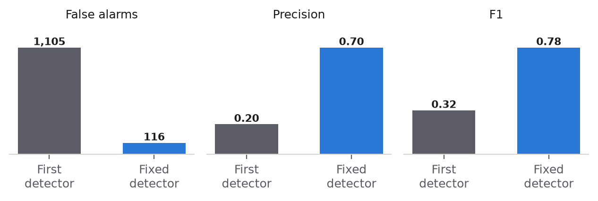

**Figure 5.** On the five held-out sessions the fixed detector cuts false alarms from 1,105 to 116 and raises precision from 0.20 to 0.70 and F1 from 0.32 to 0.78 compared with the first detector.

**Why every detector tried fails on session 0.** In cross-validation, 90 % of the remaining false alarms come from the Normal windows of two training sessions, 0 and 5, whose KPI levels differ from those of the other training sessions. Session 0 is inverted: its Normal windows score about 0.99 and its real Jamming windows about 0.01. The fold holding sessions 0, 6 and 12 scores a PR-AUC of about 0.02 for every detector tried, level-based (CatBoost) and shape-based (QUANT) alike, which places the cause in the data. Session 0 mixes 3,007 Normal windows with 93 real Jamming windows. Its "Normal" windows are an idle link (median TX 44 B, PRB ≈ 0, UL_MCS 9), which is what the Jamming of session 2 looks like (TX 8 kB, PRB 1, UL_MCS 9). The Jamming of session 0, in contrast, is a loaded link (TX 438 kB). With two contradictory jamming recordings, no classifier can separate an idle link from a link blocked by jamming. Every Normal session can also be told apart from the other sessions without error (an area under the curve, AUC, of 1.0), so a prediction on a held-out session is always an extrapolation.

**Targeted alternatives.** Two hypotheses were then tested (Table 15). For H1, that the detector relies on absolute levels, level-jitter augmentation duplicated each training window with its per-channel level shifted by a random offset drawn from the between-session spread of Normal medians, estimated inside the training fold. For H2, that shape features transfer across recordings, QUANT was used as the detector alone and averaged with CatBoost.

**Table 15.** No targeted Model 1 alternative beat the adopted detector significantly in cross-validation, and none had fewer false alarms on the five held-out sessions. TP = true positives; FP = false positives.

| Variant | CV PR-AUC | CV F1 | CV false alarms per fold | Vs adopted (corrected p) | Held-out PR-AUC · TP · FP |
|---|---|---|---|---|---|
| Adopted (both fixes) | 0.492 | 0.376 | 1,021 | — | 0.893 · 266 · **116** |
| Adopted + G (trend features) | 0.532 | 0.430 | 959 | +0.040 (p = 0.23, 20/25) | **0.917** · 270 · 123 |
| Level-jitter augmentation | **0.550** | **0.453** | **879** | +0.058 (p = 0.17, 22/25) | 0.618 · 215 · 805 |
| QUANT | 0.484 | 0.384 | 1,261 | −0.008 | 0.538 · 257 · 2,512 |
| QUANT + CatBoost | 0.527 | 0.450 | 1,035 | +0.035 (p = 0.36) | 0.886 · 267 · 124 |

Level jitter worked where it was aimed: in cross-validation, recall on the fault-only sessions 12 and 18 rose from 0.41 and 0.20 to 0.68 and 0.51. It also moved the decision boundary into the levels of the Normal-only test sessions 3 and 4, where it flagged 422 and 383 windows, so its gain did not transfer and it was rejected. QUANT alone could not separate a quiet Normal recording from a fault recording and flagged 2,117 of the 3,006 windows of session 4. Absolute levels are therefore necessary for detection, which agrees with an earlier level-free experiment by the ML team and with the scale ablation of the TelecomTS paper [1]. The trend features were the only addition better both in cross-validation and on the held-out sessions (PR-AUC 0.893 to 0.917, four more true positives and seven more false positives), but at p = 0.23 the gain, though promising, is not significant. Under the adoption rule, Model 1 remained the detector with both fixes. Session 0 kept a false-alarm rate of 94 to 98 % for every variant.

### 5.3 Fault classification: Model 2 and synthetic data

**First prototype.** The first classifier reached an accuracy of 0.677 on the test partition and a macro-F1 of 0.553 on the single train/test split. The Phase 1 report treated the single-split value as optimistic and gave as its primary figure a five-fold session-aware cross-validated macro-F1 of 0.333 ± 0.076 (95 % CI [0.267, 0.400]). With CCI-Mild and CCI-Severe merged and the two congestion classes merged, it was 0.354 ± 0.072. Regularisation lowered the single-split score (0.553 to 0.508), and SMOTE raised it (0.553 to 0.593) while lowering the cross-validated score (0.333 to 0.319); both were rejected. The report named the small anomalous sample (1,235 windows across 11 fault types) as the constraint and proposed synthetic augmentation.

**Synthetic data.** After the first prototype, Farida El Ghabary developed the v3 synthetic-fault method (Section 3.7); the first evaluation of the method found its gain consistent but not significant. Under the frozen protocol the ML team reproduced both reference models to four decimals (Sections 3.4 and 3.7). All Model 2 gains below are measured against this 25-fold baseline of 0.291, a different protocol from the Phase 1 report's five-fold estimate of 0.333. Table 16 lists the experiments that followed.

**Table 16.** Of the synthetic-data experiments for Model 2 (macro-F1 over 25 session-grouped folds), the v3 method was validated and only the trend features were adopted on top of it.

| Experiment | Result | Decision |
|---|---|---|
| v3 + Config B + FFT vs real-only | 0.374 vs 0.291, **p = 0.006, 25/25 folds** | Synthetic method validated |
| Exclude Congestion-Gradual and Buffer Overflow from augmentation | 0.377, higher variance (0.126) | No gain |
| Add trend features | **0.389**, p = 0.002 vs baseline, 24/25 | Adopted |
| Parser fix in the generator | 0.385 | Negligible; kept for correctness where possible |
| More synthetic windows: 500 → 1,000 → 2,000 per class | CatBoost 0.379 → 0.378 → 0.378 | Keep 500 |
| Synthetic data with QUANT | 0.428 (real) → 0.381 | Synthetic artefacts hurt raw-window models |

The synthetic method's gain was significant (p = 0.006) and appeared in all 25 folds, the trend features raised the score to 0.389, and more synthetic windows did not help. The ML team names three limits of the method, none of them an error. Every synthetic fault copies effects from the same 10 fault sessions, so no new session context is added. Synthetic faults sit on Normal-session backgrounds while real faults occur in fault-only sessions, so the cross-validation gain transfers only partly to the held-out sessions. The signal cache inherits the first prototype's parser, with a negligible effect on Model 2.

**Final candidates.** Six candidates were then measured both in cross-validation and on the 300 held-out fault windows (Table 17).

**Table 17.** For the Model 2 final candidates, the ranking by cross-validated macro-F1 (25 session folds) differs from the ranking by held-out macro-F1 and accuracy (300 fault windows); the last column gives held-out accuracy on the three fault sessions.

| Candidate | CV macro-F1 | Test macro-F1 / accuracy | Test accuracy, sessions 1 / 13 / 17 |
|---|---|---|---|
| v3 recipe (CatBoost + v3 + Config B + FFT) | 0.374 | 0.537 / 0.663 | 1.00 / 0.25 / 0.64 |
| **+ trend features (final)** | **0.389** | **0.591 / 0.703** | 0.99 / 0.29 / 0.72 |
| QUANT, real only | 0.426 | 0.463 / 0.623 | 1.00 / 0.10 / 0.63 |
| CatBoost + catch22, real only | 0.393 | 0.608 / 0.730 | 1.00 / 0.29 / 0.77 |
| Soft vote, CatBoost + trend and QUANT | 0.453 (p = 0.08) | 0.516 / 0.660 | 1.00 / 0.06 / 0.73 |
| Soft vote of all three | 0.446 (p = 0.051) | 0.574 / 0.697 | 1.00 / 0.16 / 0.76 |

The final Model 2 is the v3 recipe with the trend features: 0.389 in cross-validation, and on the held-out sessions a macro-F1 of 0.591 and an accuracy of 0.703 on the 300 fault windows, against 0.537 and 0.663 for the recipe alone. Figure 6 shows that the two rankings disagree. The soft votes have the highest cross-validated scores, but neither gain is significant (p = 0.08 and p = 0.051) and both fall behind the final model on the held-out sessions. CatBoost with catch22 has the best held-out scores (0.608 and 0.730) but is only 0.004 above the final model in cross-validation, and the held-out sessions were never used for selection. The QUANT and CatBoost + catch22 scores in Table 17 come from this later step and differ slightly from those in Table 13 (0.426 against 0.428, and 0.393 against 0.402).

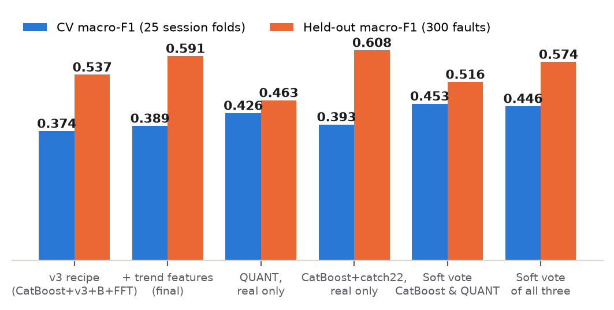

**Figure 6.** The Model 2 candidates that score highest in 25 session-grouped folds (blue) are not those that score highest on the 300 held-out fault windows (orange).

**Per-class complementarity.** In pooled out-of-fold F1, CatBoost and QUANT fail on different faults. QUANT is better on Jamming (0.99 against 0.00 for CatBoost), Doppler Shift (0.93 against 0.77) and RF Filters (0.77 against 0.34); CatBoost is better on Buffer Overflow (0.61 against 0.36) and Congestion-Sudden (0.37 against 0.00). Jamming exists in only two training sessions, and QUANT's quantile and shape features transfer between them while CatBoost's level features do not. On the held-out sessions, where both Jamming sessions are part of the training data, the advantage of the vote disappears and session 13 pulls its accuracy down.

**Congestion-Gradual against Buffer Overflow.** On the held-out sessions, 30 of the 37 Congestion-Gradual windows are labelled Buffer Overflow. A two-class specialist built from the physics of the pair (buffer growth against growth in PRB utilisation, late-to-early ratios, time to peak) re-decided the windows labelled as either class. In 25 session folds the pair F1 fell from 0.298 to 0.247 and the macro-F1 from 0.389 to 0.378. Pooled Congestion-Gradual windows labelled Buffer Overflow went from 232 of 280 to 230 of 280 and stayed at 30 of 37 on the held-out sessions. The specialist was not adopted. Trained on the same 56 and 117 real windows from at most 10 sessions, it repeats the main model's confusion, because the signature that separates the two faults is not consistently present across recordings.

### 5.4 The cascade on the held-out sessions

The final cascade passes each window to the fixed Model 1 at a threshold of 0.5 and each alarm to Model 2 (the v3 recipe with the trend features). The first prototype had shown how the cascade fails when the detector raises too many alarms. Model 2 labelled 82.2 % of its 1,105 false alarms as CCI-Mild, and CCI-Mild scored a precision and an F1 of 0.00 on its true test examples despite about 126 training windows. Model 2 has no way to say "none of the above", so it gives a Normal window the class whose boundary lies closest to normal-looking telemetry.

**Reject option: a negative result.** Raneem Alnaghy's reject option adds a Normal class to Model 2, built from the 1,000 Normal training windows that the detector finds hardest. Under the frozen protocol these windows were chosen out-of-fold, so Model 2 never sees its own validation sessions. All 1,000 have an anomaly probability of at least 0.991; they are the idle-link windows of sessions 0 and 5 (Section 5.2). Table 18 compares the reject class with a random Normal class as a control.

**Table 18.** Neither reject-class variant of Model 2 meets the promotion rule in cross-validation (25 session folds) or in the cascade on the five held-out sessions.

| Model 2 variant | CV macro-F1 | Real faults rejected (CV) | Held-out false alarms in | False alarms rejected | Residual share labelled CCI-Mild | True faults rejected | Useful precision |
|---|---|---|---|---|---|---|---|
| First prototype cascade | — | — | 1,105 | — | 82.2 % | — | — |
| No reject class (final) | 0.389 ± 0.108 | 0 % | **116** | 0 | 64.7 % (75 windows) | 0 | 0.521 |
| Hard-negative Normal class | 0.369 ± 0.116 | 19.8 % | 116 | 16 | 68.0 % | 0 | 0.549 |
| Random Normal class (control) | 0.361 ± 0.090 | 17.8 % | 116 | 21 | 66.3 % | 3 | 0.545 |

Neither variant meets Raneem Alnaghy's promotion rule (a residual catch-all share below 41.1 % and a macro-F1 within two standard deviations). The reject class addresses the first prototype's problem: its 1,105 false alarms were dominated by idle-link windows, and the original version, with the hard negatives chosen in-sample, removed 83 % of them. After the Model 1 fixes only 116 false alarms remain, and they are a different population: Normal windows of test sessions 3 and 4 whose levels resemble faults. The residual is a Model 2 confusion with CCI-Mild, the fault class nearest to normal-looking windows. Because the argmax decision also rejected 17.8 to 19.8 % of real faults in cross-validation, a probability policy was tested that rejects a window only if P(Normal) ≥ τ, for τ from 0.5 to 0.9. Fault rejection in cross-validation fell from 13 % at τ = 0.5 to 4.8 % at τ = 0.9, but the number of held-out false alarms removed fell from 13 to 0 over the same range. No threshold removes false alarms without rejecting real faults, so the final pipeline has no reject class.

**Calibration: tested and rejected.** An isotonic regression [43] fitted on out-of-fold Model 1 probabilities lowered the calibration error on the held-out sessions from 0.133 to 0.018, but mapped every raw score between 0.30 and 0.99 to the same value, 8.5 %. Of the 3,206 training windows scoring at least 0.9, 2,908 are Normal windows of sessions 0 and 5, so the map learned that a high score is usually a false alarm, which does not hold for other recordings.

**Layer 2 output, first against final.** Table 19 compares the classifier output that the first prototype passed to Layer 3 with the final output over the 6,312 test windows.

**Table 19.** On the 6,312 test windows the final cascade labels 382 windows as faults instead of the first prototype's 1,374, for almost the same number of detected faults.

| Layer 2 output | First prototype | Final cascade |
|---|---|---|
| Windows labelled as a fault | 1,374 (269 true + 1,105 false alarms) | **382 (266 true + 116 false alarms)** |
| Windows labelled Normal | 4,938 | 5,930 |
| Fault-type accuracy | 0.677 Model 2 accuracy; 0.647 cascade correctness rate as defined in the Phase 1 report | 0.748 on the 266 flagged faults; 199 of 300 true faults (0.663) correct end to end |
| False alarms labelled CCI-Mild | 82.2 % of 1,105 (≈ 908 windows) | 64.7 % of 116 (75 windows) |

The final cascade detects 266 true faults against the first prototype's 269. Figure 7 shows the false alarms and the part of them labelled CCI-Mild: the share falls from 82.2 % to 64.7 %, and the count from about 908 windows to 75.

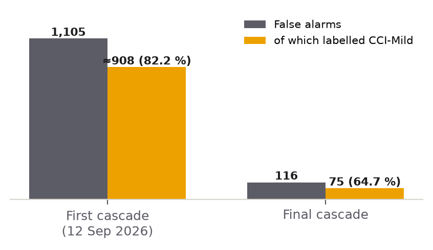

**Figure 7.** On the five held-out sessions the cascade's false alarms fall from 1,105, about 908 of them labelled CCI-Mild, in the first prototype's cascade (12 September 2026) to 116, 75 of them labelled CCI-Mild, in the final cascade.

**Remaining errors.** On the 6,312 test windows the final cascade makes 116 false alarms, including 75 labelled CCI-Mild, 20 Faulty Handover, 8 Antenna Failure and 6 Doppler Shift. It misses 34 faults: all 11 Congestion-Sudden windows, 8 RF Filters, 6 Faulty Handover, 5 Congestion-Gradual, 3 Buffer Overflow and 1 CCI-Mild. The misses belong to the classes with a quiet onset, consistent with the session analysis of Section 5.2. For example, window 595, a Faulty Handover on a loaded link (TX 400 kB, UL_BLER 0.106), receives a Model 1 score of 0.27 and is missed.

**Family-level accuracy.** Because Congestion-Gradual, Buffer Overflow and Congestion-Sudden are confused with one another (Section 5.3), the validation report also gives an accuracy for one "congestion" family containing all three. At that level the final cascade is correct on 0.75 of the true faults, against 0.663 for the exact fault type end to end.

**Uncertainty.** With only 10 training sessions that contain faults, the ML team quantified uncertainty with session-level bootstrap confidence intervals and a power analysis. The gain of the final Model 2 over the real-only baseline is large, and its interval excludes zero: +0.098 macro-F1, 95 % CI [+0.078, +0.117], Cohen's d = 1.9. The gain of the trend features over the v3 recipe is small, +0.015 (95 % CI [+0.004, +0.025], d = 0.5). A paired test would need about 31 folds, two to three times the present number of fault sessions, to reach p < 0.05. The Model 1 fix (+0.052 PR-AUC, 95 % CI [+0.023, +0.085]) and the trend features for Model 1 (+0.040, 95 % CI [+0.020, +0.065]) lie in between. A bootstrap over overlapping seed-folds is optimistic, so all adoption decisions used the corrected t-test; for the Model 1 fix, that test gave p = 0.24 (Section 5.2).

**Idle-link review flag.** Because the ambiguity of session 0 lies in the recordings, the final system flags it for review. The idle-link indicator of Section 4.3 marks 50 windows on the held-out sessions, 45 of the 116 false alarms and 5 true faults: a review queue with 90 % precision on false alarms. The 94 Jamming windows of session 1 are on a loaded link and carry no idle-link note, and no label is changed.

### 5.5 Comparison with published baselines and existing approaches

Published TelecomTS results and the project's results are not all measured under the same split, and the split decides whether a comparison is meaningful. Table 20 states for each figure whether it can be compared with the final detector.

**Table 20.** Of the TelecomTS results reported by the project and in the literature, only the first prototype's natural-rate F1 can be compared directly with the final detector; the table gives the evaluation protocol behind each figure.

| System | Reported figure | Evaluation protocol | Comparable with the final detector? |
|---|---|---|---|
| KPI-RAG final detector (Model 1) | F1 0.78 (precision 0.70, recall 0.887) | Five held-out sessions, natural test rate | — |
| KPI-RAG first prototype | F1 0.32 | Same five held-out sessions, natural test rate | Yes |
| KPI-RAG first prototype, headline of the Phase 1 report | F1 0.698 | 1,000 test windows rebalanced to 80/20 | No: different class ratio |
| Isolation Forest (baseline in the Phase 1 report) | F1 0.227 | Not stated; compared in the Phase 1 report with the 0.698 headline | No |
| Mantis [16], in the TelecomTS paper's benchmark [1] | F1 0.800 | TelecomTS paper's benchmark: random split of overlapping windows | No |
| Toto, in the TelecomTS paper's benchmark [1] | Accuracy 0.848 on fault-type classification (not a detection result) | Random split of overlapping windows | No |

Only the internal comparison is like for like: the first prototype and the final detector were evaluated on the same five held-out sessions at the natural test rate, so the change from F1 0.32 to 0.78 is a measured improvement. The headline of 0.698 in the Phase 1 report was measured on a rebalanced subset. That report does not state the evaluation set of the Isolation Forest baseline (0.227) it compared with the headline, and neither can be set beside the natural-rate results.

In the TelecomTS paper's own benchmark, Mantis [16] reaches F1 0.800 on binary detection and Toto an accuracy of 0.848 on the fault-type task [1]. That benchmark uses a random split of overlapping windows, so its numbers are not comparable with session-level results, and the project did not reproduce them; the final detector's 0.78 is set beside 0.800 without a like-for-like claim. For the same reason the final Model 2 (held-out accuracy 0.703, macro-F1 0.591, cross-validated macro-F1 0.389) is not set against Toto's 0.848 and is compared only with the project's own baselines (Section 5.3).

The explanation layer has no published figure to compare with: none of the systems reviewed in Table 1 produces a 3GPP citation that is checked automatically. The closest existing approach is ungrounded LLM generation, which condition C1 of Track C reproduces. With only the fault label and the SHAP features in the prompt, the system cites the correct specification for 5/30 windows, against 21/30 (70.0 %) when condition C3 adds the fault's row of the alignment table (matrix v1.2) and the per-window RCA evidence (Section 5.7). Condition C2 adds retrieved past incidents, the kind of context that RCACopilot retrieves (Table 1), and also scores 5/30, which is why the retrieval design is examined next.


### 5.6 Retrieval design

The first prototype retrieved the top five troubleshooting tickets with the predicted label in the query, and condition C2 of the first ablation received them. Because the tickets are one template per fault class (Section 3.10), and the prototype's 200-character snippets gave only 11 different texts, this retrieval returned the label in another form.

The retrieval experiment of Section 3.11 measured what retrieval can contribute over the 266 test faults that the detector flags. It used two reference points: the majority-class share (0.353) and the accuracy of the classifier's own label on the same windows (0.748). Table 21 lists the four designs and Figure 8 plots precision@1 against the two reference lines.

**Table 21.** Without the label in the query, only the deployed KPI-narrative ranking retrieves incidents of the true fault type above the majority-class share (0.353), and no design reaches the classifier's label accuracy (0.748). Values are shares of retrieved incidents with the window's true fault type, over the 266 detected test faults.

| Design | Precision@1 | Precision@5 |
| --- | --- | --- |
| Ticket documents, label in the query (first prototype) | 0.707 | 0.686 |
| Ticket documents, label removed | 0.102 | 0.069 |
| KPI narratives, label-free query (deployed ranking) | 0.451 | 0.335 |
| KPI narratives, all paragraphs averaged | 0.049 | 0.201 |

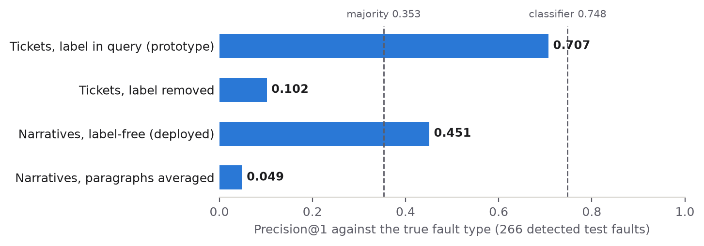

**Figure 8.** With the label in the query, retrieval repeats the label and still scores below the label itself (0.748). Without it, ticket text falls below the majority share (0.353), and KPI narratives reach 0.451, modestly above it (precision@1 over the 266 detected test faults).

With the label in the query, ticket retrieval scored 0.707, below the 0.748 of the label it was echoing. Without the label, ticket text carried almost no signal (0.102, below the majority share). Narratives with a label-free query reached 0.451, modestly above the majority share. Averaging the embeddings of all narrative paragraphs performed far worse (0.049), which is why the deployed index keeps the narrative truncated to the embedding model's input window (Section 3.10).

Retrieval over this corpus cannot replace the classifier's label, so the final design ranks KPI narratives within the predicted fault type, selected by a metadata filter (Section 3.10). Over the 382 alarms of the test sessions, the top retrieved incident's similarity ranges from 0.59 to 0.75 (median 0.72), and the low-confidence flag (similarity below 0.35) never fired.

### 5.7 Citation grounding: Track C from the first ablation to the final run

Track C addresses RQ2: does grounding in the alignment table (matrix v1.2) raise citation faithfulness over ticket-only and ungrounded generation? The ablation was first run on the prototype and later repeated under a revised protocol.

**First ablation.** The first prototype ran the three-condition ablation over 30 test windows, 3 for each of the 10 fault types with a 3GPP reference (Jamming excluded), drawn with `random.seed(42)`. C1 gave the LLM the fault type label and signal statistics; C2 added the top five retrieved tickets; C3 added the RCA evidence and the alignment table row. A citation counted as valid if it passed the format check and appeared in the alignment row of the predicted fault type. C1 produced 2/30 valid citations (7 %), C2 3/30 (10 %) and C3 27/30 (90 %). C2 and C3 each had one template fallback (Section 5.10), counted as invalid. The Phase 1 report read the result as a gain of 80 percentage points (pp) from C2 to C3 that passed the O4 criterion of 70 %. It also noted that C3 measured prompt compliance: whether the LLM uses the correct standard when it is given in the prompt.

**Why the protocol changed.** A later audit of the ablation runs showed that the design measured more than grounding. Runs that sampled windows by predicted label mixed Normal and misclassified windows into the sample, so the score depended on the classifier as well as on the prompt. Only C3 carried a "use TR ..., e.g. TR 38.901" hint and KPI-specific field descriptions. The validator accepted any fault's primary standard for Jamming, which has no 3GPP reference, and the alignment table's move of Faulty Handover from TS 38.133 to TS 38.331 changed the score of earlier runs on re-scoring. The final design (Section 3.11; scoring rules in Appendix F) samples 3 windows per true fault type, scores each citation against the true fault's row and counts a missed window as incorrect. It gives all three conditions one instruction block and adds two answer rules that need no LLM as reference points.

**Final run.** Of the 30 windows sampled by true fault, the classifier labels 19 correctly, misclassifies 5 and misses 6. That leaves 24 windows with an explanation and 72 LLM calls, none of which fell back to the template (Section 5.10); the C3 evidence block was injected in all 24 explained windows. Table 22 gives the counts, and Figure 9 shows the three LLM conditions next to the two rules without an LLM.

**Table 22.** In the final Track C run (30 windows, 3 per true fault type), C3 and the copy-row rule both cite a correct standard for 21 of 30 windows, against 5 of 30 for C1 and C2. "Correct" is scored against the true fault's row; "valid vs predicted" against the row of the fault the classifier named, over the 24 windows with an explanation.

| Answer rule | Correct vs true fault (n = 30) | Wilson 95 % CI | Classified correctly (n = 19) | Valid vs predicted row (n = 24) |
| --- | --- | --- | --- | --- |
| C1 LLM: label + SHAP | 5/30 (16.7 %) | 7.3-33.6 % | 4/19 | 7/24 |
| C2 LLM: + past incidents | 5/30 (16.7 %) | 7.3-33.6 % | 4/19 | 7/24 |
| C3 LLM: + alignment row + RCA evidence | 21/30 (70.0 %) | 52.1-83.3 % | 19/19 | 24/24 |
| No LLM: always cite TS 38.141-1 | 12/30 (40.0 %) | — | — | — |
| No LLM: cite the predicted fault's row | 21/30 (70.0 %) | — | 19/19 | 24/24 |

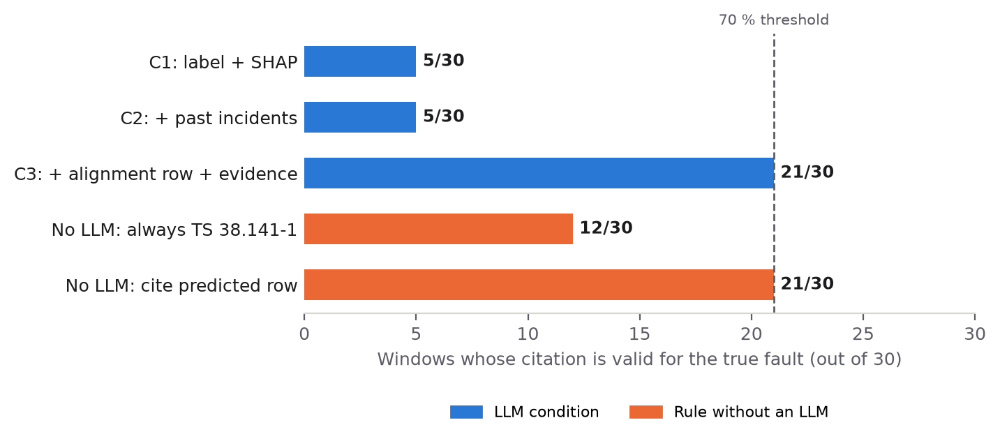

**Figure 9.** C3 reaches the 70 % threshold with 21 of 30 windows valid for the true fault and matches the rule that copies the predicted fault's row. C1 and C2 fall below the fixed answer TS 38.141-1 (final Track C run, three LLM conditions and two answer rules without an LLM).

Grounding raises citation correctness from 5/30 in C1 and C2 to 21/30 (70.0 %, Wilson 52.1 to 83.3 %) in C3, a gain of 53 pp. Moving from C2 to C3 improves 16 windows and worsens none (exact McNemar p = 3.1·10⁻⁵), and the same holds from C1 to C3 (16 better, 0 worse, p = 3.1·10⁻⁵). Retrieved incidents change nothing: C2 cites the same standard as C1 in all 24 explained windows. Without the table, the LLM cites TS 38.104 (12 windows), TS 38.331 (8) and TS 38.214 (4), and both C1 and C2 score below the fixed answer TS 38.141-1 (12/30). When the classifier's label is correct, which puts the correct standard in the prompt, C3 cites it in 19/19 windows (Wilson 83.2 to 100 %). In all 24 explained windows the LLM adopted the standard it was given (24/24 valid against the predicted row), so C3 scores exactly what the copy-row rule scores (21/30).

The run was repeated on 18 October 2026 after the team edited 61 of the 289 C3 evidence blocks to match the Layer 2 SHAP top three (Section 3.10). Only 3 of the 24 blocks that reach a C3 prompt changed (windows 607, 700 and 715), and C3 was identical to the previous run in every window. The C1 total did not change (window 658 now cites TS 38.104 instead of TS 36.104), and C2 fell from 7/30 to 5/30 (windows 684 and 686 now cite TS 38.331 instead of TS 38.321). The C1 and C2 prompts contain no RCA evidence, so these differences are run-to-run variation of the LLM at temperature 0.1, not an effect of the edit.

**Where the remaining errors come from.** Figure 10 breaks the 30 C3 outcomes down. In 19 windows the fault was classified correctly and the citation is correct. Two windows were misclassified but still score correctly: the CCI-Mild window 645 and the CCI-Severe window 703, both predicted as RF Filters, whose row lists TS 38.141-1 like their true rows. Three windows were misclassified and received the wrong row: 845 and 846 (Congestion-Gradual, predicted as Buffer Overflow) and 648 (Faulty Handover, predicted as RF Filters). The remaining six (717, 682, 879, 866, 827 and 843) were missed by the detector and have no explanation; they are all three Congestion-Sudden windows, one Congestion-Gradual, one Buffer Overflow and one Faulty Handover window. Every C3 error therefore starts upstream of the explanation layer.

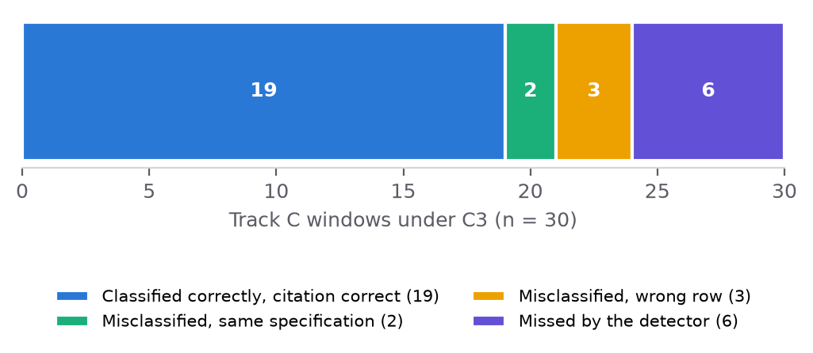

**Figure 10.** Under C3, 19 of the 30 Track C windows are classified correctly with a correct citation, 2 are misclassified onto a row with the same specification, 3 are misclassified onto the wrong row, and 6 are missed by the detector.

Window 611 (Doppler Shift, classified correctly; Appendix D) shows the difference in a single case. C1 and C2 both cite TS 38.104 and name the Near-RT RIC. C3 cites TR 38.901, names the O-RU / O-DU, and ties its root cause to the window's evidence: "Severe Doppler shift caused by high user equipment velocity resulting in rapid channel phase variation, evidenced by high RSRP variance (std |SHAP|=0.654, fft energy |SHAP|=0.510) and degraded downlink modulation (DL_MCS mean=6, |SHAP|=0.484)."

**From the first ablation to the final run.** Figure 11 places the two runs side by side. The two bars of each pair measure different quantities. The first ablation counted a citation as valid against the predicted fault's row; the final run samples by true fault and counts a citation as correct only against the true row, with detector misses scored as incorrect. The fall from 27/30 to 21/30 in C3 is therefore a change of definition, not a decline. The final-run figure closest to the first ablation's definition is validity against the predicted row, 24/24.

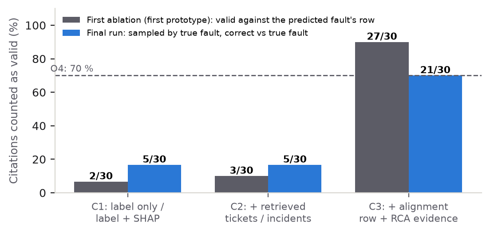

**Figure 11.** Each pair of bars sets the first ablation (valid against the predicted fault's row) beside the final run (sampled by true fault, correct against the true fault) for one condition. The two runs use different definitions, so a pair is not a like-for-like comparison.

**Interpretation.** The C3 figure of 21/30 measures how often the deployed system, from detection to explanation, cites a specification that governs the window's true fault; clause numbers are not checked. Because the correct standard is in the C3 prompt whenever the classifier is right, the 19/19 result measures how reliably the LLM adopts a standard supplied by the curated table and held to it by the validator. The LLM's own knowledge of 3GPP standards is measured by C1 (5/30), and the quality of the text around the citation by Track B (Section 5.8). The O4 criterion of 70 % was written for a "regex-validated 3GPP clause check"; the final run applies it at specification level.

### 5.8 Explanation quality: Track B

Track B, designed and run by Rodina Khallaf, scores KPI-RAG explanations of 30 fault windows, 3 per fault type across 10 fault types, with an LLM-as-judge protocol based on G-Eval [41] (Section 3.11). Each explanation is scored against a structured ground-truth reference on the four dimensions of Table 29 (Appendix F). No inference errors were reported across the 30 windows. Table 23 and Figure 12 give the results per dimension. The composite mean is 3.59 / 5 with a standard deviation (SD) of 0.28. All four dimension means fall between 3.50 and 3.63, with actionability lowest (3.50), and every individual dimension score lies between 3 and 4.

**Table 23.** Actionability has the lowest Track B dimension mean (3.50), citation validity and fault specificity the highest (3.63), and every individual score is 3 or 4. Scores are on a 1 to 5 integer scale (n = 30 fault windows); the composite is the unweighted mean of the four dimensions.

| Dimension | Mean (/ 5) | SD | Min | Max |
| --- | --- | --- | --- | --- |
| Citation validity | 3.63 | 0.49 | 3 | 4 |
| Fault specificity | 3.63 | 0.49 | 3 | 4 |
| Actionability | 3.50 | 0.51 | 3 | 4 |
| Causal soundness | 3.60 | 0.50 | 3 | 4 |
| Composite (mean of 4) | 3.59 | 0.28 | — | — |

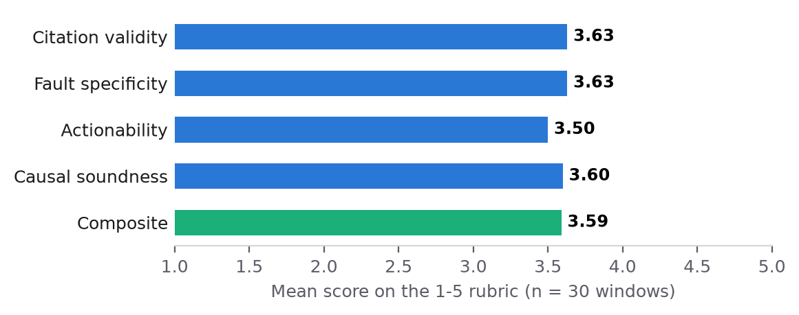

**Figure 12.** The four Track B dimension means lie within a narrow band of 3.50 to 3.63 on the 1 to 5 G-Eval rubric, and the composite is 3.59 (n = 30 windows).

On the citation dimension, the judge rated the cited specification correct, regardless of clause precision, in 19 of 30 windows (63.3 %); the other 36.7 % cite a valid TS document that is less directly applicable than the ground-truth reference. This rate comes from an LLM judge, so it is a different measure from the Track C counts of Section 5.7. Every window that cites the correct TS scores 4 and not 5 because it omits the specific clause (for example §7.8 of TS 38.141-1, or §5.4.3.1.3 of TS 38.321). The answer field of the explanation prompt asks only for a specification number ("TS XX.XXX or TR XX.XXX"). The Track B report proposes adding normative clause data to the knowledge base as the remedy.

Table 24 reports the dimension means per fault type (n = 3 windows each). For Doppler Shift, fault specificity is 4.00 because the mechanism is identified correctly, while actionability falls to 3.00 because the actions suggest generic channel-estimation improvements without parameter values. The Congestion-Sudden windows score 3.33 or below on every dimension. The judge notes that they are often conflated with coverage degradation, with RSRP and the signal-to-noise ratio (SNR) treated as causes instead of secondary effects, and that their burst-and-subside temporal signature is not captured in the KPI chain.

**Table 24.** Track B dimension means vary by fault type, and Congestion-Sudden scores 3.33 or below on every dimension (n = 3 windows per type, rows in the order of the Track B report). Cite = citation validity; Spec = fault specificity; Act = actionability; Causal = causal soundness.

| Fault type | n | Cite | Spec | Act | Causal |
| --- | --- | --- | --- | --- | --- |
| Antenna Failure | 3 | 4.00 | 3.67 | 4.00 | 3.67 |
| CCI-Mild | 3 | 4.00 | 3.67 | 3.67 | 3.67 |
| CCI-Severe | 3 | 4.00 | 3.67 | 3.00 | 4.00 |
| Faulty Handover | 3 | 3.67 | 4.00 | 4.00 | 3.33 |
| RF Filters | 3 | 3.67 | 3.67 | 4.00 | 3.67 |
| Resource Allocation Bugs | 3 | 4.00 | 3.33 | 4.00 | 3.33 |
| Doppler Shift | 3 | 3.00 | 4.00 | 3.00 | 4.00 |
| Congestion-Gradual | 3 | 3.33 | 3.67 | 3.00 | 3.67 |
| Buffer Overflow | 3 | 3.33 | 3.33 | 3.33 | 3.33 |
| Congestion-Sudden | 3 | 3.33 | 3.33 | 3.00 | 3.33 |

Across all 10 fault types, the judge credits the explanations for identifying the primary fault mechanism (for example, co-channel interference leading to an uplink SNR collapse and a throughput drop). It also credits them for naming the correct O-RAN component and for a directionally correct cause-to-KPI narrative. The judge records three recurring gaps. The first is the missing clause number described above. The second is an incomplete intermediate symptom chain: explanations usually skip the BLER rise and the floor in the modulation and coding scheme (MCS) that link the primary fault to the throughput KPI. Antenna Failure explanations, for example, go from a degraded antenna to low RSRP without the BLER rise that forces the lower MCS. The third is under-parameterised actionability: the actions identify the right subsystem and configuration area (MAC scheduler, physical cell identity (PCI) planning, buffer status report (BSR) timer) but give no parameter names, thresholds or target ranges. The Track B report identifies this gap as the largest single opportunity for improvement.

### 5.9 Knowledge scope: Track D

Track D, also by Rodina Khallaf, characterises the boundary of the system's knowledge outside fault diagnosis (Section 3.11). It compares the LLM without context and with context retrieved from the 935-ticket knowledge base on 600 TeleQnA questions [33], 200 from each of the Standards specifications, Standards overview and Lexicon categories. Track D therefore measures retrieval over that ticket corpus on out-of-domain questions.

At the coverage threshold τ = 0.50, only 13 of the 600 questions (2.17 %) are supported, and 193 (32.2 %) pass the lower τ = 0.35, the same value as the system's low-confidence flag. The median retrieval score across all 600 questions is below 0.31. The Track D report reads this as a correct self-assessment by the retriever: the 935 documents describe KPI anomaly events and contain almost no text close to standards specifications or glossaries. In the ungated run, however, the retrieved chunks are prepended to every question regardless of coverage. Table 25 gives coverage and accuracy by category, and the left panel of Figure 13 compares the two conditions.

**Table 25.** On 600 TeleQnA questions, retrieval coverage at τ = 0.50 is 2.17 %, and ungated KPI-RAG retrieval lowers multiple-choice accuracy below the no-context baseline in every category, most in Lexicon. Δ = KPI-RAG minus baseline, in pp.

| Category | Questions | Supported (≥ 0.50) | Coverage | Baseline | KPI-RAG | Δ |
| --- | --- | --- | --- | --- | --- | --- |
| Standards specifications | 200 | 10 | 5.0 % | 67.0 % | 61.0 % | −6.0 pp |
| Standards overview | 200 | 1 | 0.5 % | 75.0 % | 53.0 % | −22.0 pp |
| Lexicon | 200 | 2 | 1.0 % | 87.0 % | 41.5 % | −45.5 pp |
| Overall | 600 | 13 | 2.17 % | 76.3 % | 51.8 % | −24.5 pp |

Injecting the chunks lowers overall accuracy from 76.3 % to 51.8 % (−24.5 pp). The Track D report attributes the drop to context poisoning [34]: conditioned on fault-diagnosis narratives about interference, jamming and congestion, the LLM partly overrides answers it would otherwise get right. One inspected case is question q00021, on the scrambling-sequence initialisation for the UE-specific search space of the physical downlink control channel (PDCCH), with the expected answer `pdcch-DMRS-ScramblingID` from TS 38.211. Its top chunk (score 0.217) described an external RF jamming incident, and the answer changed from correct to wrong. Lexicon loses most (−45.5 pp), because the baseline holds vocabulary definitions with high confidence, so irrelevant context is enough to displace them. Standards specifications loses least (−6.0 pp), because these questions are harder for the baseline as well and some chunks contain incidental technical terms.

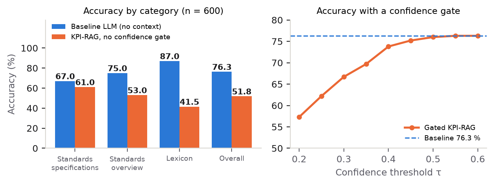

**Figure 13.** On 600 TeleQnA questions, ungated KPI-RAG loses accuracy against the baseline LLM in every category, most in Lexicon (left), and the overall accuracy of the gated system recovers to the 76.3 % baseline as the confidence threshold τ rises (right).

To measure how much of the loss comes from forced injection, the Track D analysis applied a confidence gate after the fact to the stored answers, with no further LLM calls. The gate keeps the KPI-RAG answer only when the top retrieval score reaches τ and uses the baseline answer otherwise. The right panel of Figure 13 shows the sweep (full values in Appendix G). Accuracy rises steadily with τ, from 57.3 % at τ = 0.20 (496 questions use retrieval) to 69.7 % at τ = 0.35 (193 questions) and 75.2 % at τ = 0.45 (33 questions). At τ = 0.50, where exactly the 13 supported questions use retrieval, accuracy is 76.0 % (−0.3 pp), which recovers 98.8 % of the gap (24.2 of 24.5 pp). At that threshold Standards specifications returns to its baseline (67.0 %), while Lexicon (86.5 % against 87.0 %) and Standards overview (74.5 % against 75.0 %) each remain 0.5 pp below, from the 2 and 1 questions that clear the gate. At τ = 0.55 only one question uses retrieval and accuracy is identical to the baseline (76.3 %). The Track D report interprets Track D as a characterisation of scope and not as a failure on the system's own task. It proposes the confidence gate, which needs no further LLM calls, as a mitigation for RAG systems used outside their evidence domain.

### 5.10 Reliability and testing

The first prototype showed that the free-tier LLM quota was a practical constraint. Fixed linear backoff (30, 60 and 90 s) proved insufficient for evaluation-scale runs of 90 sequential calls, and a rate limiter was added (Section 4.5). The reported first ablation ended with two template fallbacks: a parse failure in C2 and three consecutive rate-limit (HTTP status 429) responses in C3. All 118 tests of the first prototype passed, including four negative tests that the first prototype's audit added to keep citation validation fault-specific (Section 3.10).

Under the final error-handling policy (Section 4.5), all 72 calls of the final Track C run returned a valid JSON answer with no template fallback, and four rate-limit responses were retried successfully. The Phase 1 report had set a target of fewer than 15 % template fallbacks; the final run had 0 of 72. The test suite, built by Ahmed Al Shobaki, grew to 210 tests in 29 modules, of which 207 pass on the final code and 3 are skipped (Section 4.7). Chapter 6 interprets these results against the research questions and the objectives.


## 6. Discussion

### 6.1 Interpretation by research question and by layer

**RQ1 (scale-preserving features).** The evidence answers this question only in part. In the first prototype, under the window-level split, the statistics-only configuration (Config A, 64 features) outperformed the 320-dimensional configuration with patchwise scale and the full 582-dimensional vector on both detection and classification. The Phase 1 report explained this by the low ratio of training samples to features (Section 5.1). Those runs used the leaky split, and the ML team (Farida El Ghabary and Raneem Alnaghy) later found that Config A had been chosen on the test set. The three-configuration ablation was not repeated under the session-level protocol. The clearest session-level evidence concerns absolute levels. QUANT, a shape-based method, could not separate a quiet Normal recording from a fault recording (it flagged 2,117 of 3,006 windows in test session 4), and the ML team concluded that absolute levels are necessary for detection (Section 5.2). The classifier's cross-validated gain over the real-only baseline (0.291 to 0.389) combines synthetic data with new features, so it does not isolate the effect of scale.

**RQ2 (alignment-table grounding).** Yes, at specification level and on the 30 sampled windows. In the final Track C run, grounding in the alignment table (matrix v1.2) raises citation correctness from 5/30 without the table (C1, and C2 with retrieved incidents) to 21/30, and to 19/19 when the classifier's label is correct. C3 scores the same as the rule that copies the predicted fault's row. The gain therefore comes from the table: it reaches the prompt, the LLM adopts the standard it is given (24/24), and the validator holds the answer to it. Ticket or incident retrieval alone adds little or nothing to the citation: 2/30 to 3/30 in the first ablation, 5/30 to 5/30 in the final run. The first ablation's 27/30 and the final 21/30 measure different things (Section 5.7). None of the nine remaining errors arises in the explanation layer.

**RQ3 (performance-to-cost trade-off).** This question is also answered only in part. The first prototype chose the 64-dimensional Config A partly for its samples-per-feature ratio, and the final detector keeps it. The final classifier adds trend features to the v3 recipe of Farida El Ghabary for a small gain (+0.015 macro-F1, 95 % CI [+0.004, +0.025], Cohen's d = 0.5). Doubling or quadrupling the synthetic windows per class brought no gain (0.379, 0.378, 0.378 for 500, 1,000 and 2,000). Training and inference costs of the feature configurations were not reported, so the trade-off can be stated in dimensionality only.

**Layers 1 and 2.** The two Model 1 fixes cut false alarms on the held-out sessions from 1,105 to 116 and raised F1 from 0.32 to 0.78 with recall almost unchanged. The final cascade names the exact fault type for 199 of the 300 true faults (0.663). The ML team traced the remaining errors to the data. Session 0's Normal windows are an idle link that resembles one of the two Jamming recordings, and the signature that separates Congestion-Gradual from Buffer Overflow is not consistently present across recordings (Sections 5.2 and 5.3). The detector misses all 11 Congestion-Sudden test windows (Section 5.4), which is why the three Congestion-Sudden windows of Track C have no explanation.

**Layer 3.** The alignment table (Rodina Khallaf) is the artefact on which the citation result rests: 11 rows, 10 of them mapped to 3GPP Release 19 clauses and an O-RAN component, and Jamming, which has no 3GPP reference. Retrieval does not supply the standard. On TelecomTS the tickets are class templates, and the per-window narratives identify the class only modestly above the majority-class share (precision@1 0.451 against 0.353), so retrieval contributes KPI patterns from comparable incidents within the predicted class. Track D shows the same limit of retrieval on out-of-domain questions: adding retrieved context lowered TeleQnA accuracy by 24.5 pp. As Section 2.3 noted, retrieval helps only when the store holds something the model does not already have. Rodina Khallaf attributes the drop to context from an evidence store of fault-diagnosis tickets that holds almost nothing close to standards text. Track B places the quality of the explanation text at 3.59 / 5, with clause numbers, intermediate symptoms and concrete parameters as the recurring gaps.

### 6.2 Were the objectives met?

Table 26 assesses the five objectives of Section 1.3 against the evidence of Chapters 4 and 5. An objective is marked met only when the reported evidence covers its stated criterion.

**Table 26.** Against the reported evidence, objectives O2 and O5 are met, O4 is met at specification level, and O1 and O3 are partly met.

| Objective | Evidence | Status |
| --- | --- | --- |
| O1 Two-stage detection and classification on TelecomTS, quantifying the contribution of absolute-scale features | Model 1 on the 5 held-out sessions: F1 0.78, precision 0.70 (266 of 382), recall 0.887 (Section 5.2). Model 2: CV macro-F1 0.389 (25 session folds), test macro-F1 0.591 (Section 5.3). The scale contribution was quantified only under the superseded window-level split (Section 5.1); at session level only the detector experiments show that absolute levels are needed (Section 5.2) | Partly met |
| O2 Alignment table linking the injected fault types to 3GPP clauses and O-RAN components | Table v1.2: 11 rows, 10 mapped to Release 19 clauses and O-RAN components, all 10 marked Confirmed; first version built from the GSMA knowledge graphs and checked against primary specification text, with 10/10 fault types supportable (Sections 3.9 and 4.4); the table supplies the standard in C3 (Section 5.7) | Met |
| O3 Retrieval with a SHAP-based query; acceptable precision@k | Label-free query from the SHAP channels, their directions and KPI means over a training-only index; precision@k measured against the true fault type (precision@1 0.451, majority-class share 0.353), not on held-out alignment-table queries; the class comes from a filter (Section 5.6) | Partly met |
| O4 Grounded explanations; at least 70 % pass the citation check | Track C: 21/30 (70.0 %) correct for the true fault, 19/19 when classified correctly; checked at specification level, clause numbers not checked (Section 5.7) | Met (specification level) |
| O5 Joint evaluation of detection and explanation | Track A on the held-out sessions (Sections 5.2 to 5.4); Track C sampled by true fault with detector misses counted as incorrect (Section 5.7); Track B (G-Eval) and Track D (TeleQnA) (Sections 5.8 and 5.9) | Met |

O4 is met at specification level, the level the validator checks. The point estimate equals the threshold (the Wilson interval is 52.1 to 83.3 %), and the criterion as first written referred to a clause check, which the final system does not perform. O1 and O3 are partly met for the reasons in the table: in each case the system was built and measured, but the criterion as written was not measured under the final protocol.

### 6.3 Lessons from building the system

Much of the project's work, in the first prototype and after it, consisted of finding cases where a component produced plausible output for the wrong reason. Chapters 3 to 5 describe each defect where it arises; four lessons recur across them.

**Check the evaluation as closely as the model.** Several defects made results look better than they were. The window-level split left 31.8 % of test windows with a near-duplicate training window (Section 3.3). The first validator accepted any well-formed reference for any fault, and a later one accepted any primary standard for Jamming (Sections 3.10 and 5.7). Ticket retrieval looked accurate only because the predicted label was in the query (Section 5.6), and Track C runs sampled windows by predicted label and gave the conditions different instructions (Section 5.7). The ML team's audit also corrected the written record. The follow-up investigations reported with the first prototype's feature ablation came from notebooks that had not been executed in their submitted state, and Config A had been chosen on the test set (Sections 3.4 and 5.1). The residual near-duplicate rate reported after the split fix could not be reproduced (Section 3.3), and the Layer 2 export had chosen the SHAP source from the ground-truth label (Section 4.3).

**Make silent failures visible.** Five defects produced no error. In the features, six protocol columns were zero-filled and a parser read "1.e-05" as two numbers in 492 training windows (Section 3.5). In Layer 3, a Doppler Shift row cited as TS 38.901 made every Doppler check fail (Section 3.9), and the RCA evidence reached the dashboard but not the prompt (Section 3.10). In the packaging, an index rebuild emptied the committed index (Section 4.7). Each is now guarded by a validation gate, a negative test or a fail-closed default.

**Require a gain to survive a second test.** Level-jitter augmentation was the best detector variant in cross-validation and flagged 805 Normal windows on the held-out sessions (Section 5.2). The soft votes scored highest in cross-validation and lower on the held-out sessions (Section 5.3). The isotonic calibration lowered the calibration error from 0.133 to 0.018 while mapping every raw score between 0.30 and 0.99 to 8.5 % (Section 5.4). None of the three was adopted.

**Fix a defect in the component where it starts.** In the explanation layer, Ahmed Al Shobaki traced each of the following problems to its source and fixed it there. Retrieval had returned the label in another form and its index used the wrong distance metric (Sections 3.10 and 5.6), and the Track C protocol had measured the classifier as well as the grounding (Section 5.7). The prompts printed every SHAP entry as support, although 97 of the 1,146 top-three entries push away from the predicted class (Section 3.8), and the evidence block carried an outdated standard and labels derived from the test split (Section 3.10). The dashboard listed training windows whose own narratives were in the index and had two interface defects (Section 4.6), and four packaging defects affected deployment and reproduction (Section 4.7).

### 6.4 Practical implications

For a network operations team, the main practical result is that an LLM explanation can carry a dependable standards citation if the standard comes from a curated table and the answer is checked against it. Without the table, the model's own choice scored below always giving the same answer (Section 5.7). The dashboard shows the citation check, the retrieved precedents and the evidence that went into the prompt, so an engineer can see why an explanation says what it says and can tell a template answer from a model answer.

All nine C3 errors started upstream of the explanation layer, and a misclassified window receives a confident-looking explanation for the wrong fault. Better detection and classification is therefore the most direct way to improve the explanations end to end. The final detector raises 382 alarms on the held-out sessions at a precision of 0.70, and the idle-link indicator gives operators a review queue of 50 flagged windows, 45 of them false alarms. Where the congestion pair cannot be separated, the ML team reports a family-level accuracy (0.75 of the 300 true faults) beside the exact-type accuracy (199 of 300, 0.663).

Track D adds a rule for retrieval outside the system's own domain. Injecting weakly related context cost 24.5 pp of accuracy on TeleQnA standards and lexicon questions, and gating retrieval on its similarity score recovered almost all of it without further LLM calls. Rodina Khallaf therefore proposes this gate for RAG systems used outside their evidence domain.

### 6.5 Limitations

**Data.** All models are trained on 10 training sessions that contain faults, two of them with Jamming, and the ML team identifies this as the dominant limit for both models. Two problems remained unresolved by every model tried: session 0, where an idle link and a link blocked by jamming look alike, and the Congestion-Gradual and Buffer Overflow pair. The ML team notes that both need more recordings, especially of jamming with and without traffic, or richer context (traffic activity, mobility) in the labels. Every Normal session can be told apart from the other sessions without error (AUC 1.0), so a held-out session is always an extrapolation. The data come from a single indoor 5G testbed with 10 injected fault types and one controlled real one; results on multi-vendor, multi-cell or operator data would need a new evaluation. Model confidence is the raw model probability, since the tested calibration was rejected.

**Evaluation.** Track C uses 30 windows per condition, 3 for each of the 10 injected fault types, drawn from the held-out sessions, so its intervals and p-values are descriptive. Its metric is specification-level, with clause numbers unchecked, and in C3 the standard is in the prompt (Section 5.7). Track B scores 30 explanations with one LLM judge and no human raters. Track D tests the system on out-of-domain questions, so it describes the scope of the knowledge base and not performance on the diagnosis task. The Model 1 fix lowers false alarms in 25 of 25 cross-validation folds, but the corrected test gives p = 0.24. The gain of the trend features would need about 31 folds, two to three times the present number of fault sessions, to reach p < 0.05.

**Provenance.** For Track B, the judge model, the generator run and explanation file behind the 30 windows, and whether the windows were sampled by true or predicted fault type are not documented. Its scores therefore cannot yet be tied to a particular explanation set and are not compared with Track C. For Track D, the LLM, the embedding model and the number of retrieved chunks are not documented, and the knowledge base is described as 935 fault-diagnosis telemetry tickets. The first-prototype results that the ML team's audit could not reproduce are reported only as history.

**Single LLM.** All explanation runs use Gemini 3.5 Flash Lite [7] at temperature 0.1 and one seed, on a free-tier quota. The model name is accepted by the API but is not in Google's public model list. Repeating the final run changed the citation of one C1 window and two C2 windows, although their prompts contain no RCA evidence, so even at a low temperature the ungrounded conditions vary from run to run. A second model would show how far the grounding result depends on this one.

**Corpus.** The retrieval corpus holds no resolution text, so retrieved incidents contribute comparable KPI patterns and not records of past fixes.

Chapter 7 summarises what the project achieved and turns these limitations into future work.


## 7. Conclusion and Future Work

### 7.1 Main achievements

The project set out to detect, classify and explain faults in 5G KPI time series, with explanations whose standards citations can be checked. From the first prototype (September 2026) to the final system (October 2026) the team built and evaluated a working pipeline and replaced several early results with more reliable ones. Measured against the proposal, objectives O2 and O5 were met, O4 was met at specification level, and O1 and O3 were partly met because their criteria as written were not measured under the final protocol (Section 6.2).

1. **An evaluable end-to-end system.** KPI-RAG takes a 128-step window of 16 numerical KPI channels, flags it, names one of 11 fault types and attributes the decision to KPIs with SHAP. It then retrieves comparable past incidents and returns a structured explanation with an automatically validated 3GPP citation and an O-RAN component. A six-panel Streamlit dashboard, deployed on Streamlit Community Cloud, presents each step; it runs retrieval and the explanation live on stored or uploaded classifier outputs.
2. **A sound evaluation protocol for the models.** The first prototype began with a window-level split that let overlapping windows appear on both sides, and replaced it with a hold-out of five of 33 reconstructed recording sessions. The final system keeps that split and adds a frozen protocol of 25 session-grouped folds with a corrected paired test and a pre-stated adoption rule.
3. **A detector that is usable at the natural fault rate.** Fixing a doubly applied class-imbalance correction and a feature-parsing defect reduced false alarms on the held-out sessions from 1,105 to 116 and raised F1 from 0.32 to 0.78 (precision 0.70, recall 0.887).
4. **A better fault classifier, validated statistically.** Synthetic fault data (the v3 method of Farida El Ghabary) and trend features raised the cross-validated macro-F1 from 0.291 to 0.389 (p = 0.002); the synthetic-data gain alone appeared in 25 of 25 folds (p = 0.006). On the held-out sessions the classifier reaches an accuracy of 0.703 and a macro-F1 of 0.591.
5. **A standards artefact.** The alignment table (matrix v1.2, Rodina Khallaf) maps the ten injected fault types to 3GPP Release 19 clauses and O-RAN components, with the causal mechanism behind each mapping. Its row for Jamming, which has no 3GPP reference, records a real over-the-air condition with no 3GPP clause or O-RAN target.
6. **Dependable standards citations once the fault is known.** In the final citation ablation, grounding raised correct citations from 5 of 30 (label and SHAP only, and with retrieved incidents) to 21 of 30 (70.0 %), equal to the O4 threshold and checked at specification level. When the classifier's label was correct, 19 of 19 citations were correct. Every remaining error originated in detection or classification.
7. **A reproducible codebase.** The final test suite has 210 tests in 29 modules (207 pass, 3 need a Groq API key), and with locked dependencies and the committed split indices and index, a fresh clone runs the tests and the dashboard.

### 7.2 Contributions

- **Artefact.** The alignment table is a fault-to-standard mapping for the TelecomTS fault taxonomy that links each injected fault type to 3GPP Release 19 clauses, an O-RAN component and its observable KPI signature.
- **Method.** The citation ablation samples by true fault type, scores every citation against the true fault's row and reports two answer rules that need no LLM, so that a citation gain can be attributed to its source.
- **Empirical findings.** On TelecomTS, synthetic faults built from training sessions improve classification significantly, but more synthetic windows do not help, and every synthetic fault reuses effects from the same ten fault sessions. Absolute KPI levels are needed for detection, and because every Normal session can be told apart from the others without error, every unseen recording is an extrapolation. The dataset's troubleshooting tickets are one template per class, so retrieval over them returns the label in another form. Citations are dependable when a curated standards table is injected into the prompt and each citation is checked against it, and not when the language model chooses the standard itself. Out of domain, injecting irrelevant retrieved context lowers accuracy, and a confidence gate on retrieval removes almost all of that loss.

### 7.3 Future work

- **More fault recordings.** The dominant limit is the number of fault sessions (ten, two with Jamming). The ML team estimates that two to three times as many fault sessions are needed before small model gains can reach significance. Recordings of jamming with and without traffic are needed to separate an idle link from a blocked one (Section 6.5).
- **Richer labels and context.** Traffic activity and mobility information in the labels would help with session 0 and with the Congestion-Gradual and Buffer Overflow pair, which no model tried could separate (Section 6.5). It would need to be recorded independently of the fault labels, so that it cannot act as the shortcut described in Section 3.2.
- **Clause-level grounding.** Add normative clause text to the knowledge base, validate citations at clause level, and add a test the prompt cannot answer, for example by withholding the table for some fault types.
- **Better explanations.** Address the three gaps the LLM judge identified: missing clause numbers, skipped intermediate symptoms (the BLER rise and MCS floor), and remediation actions without concrete parameters. Check the judge's scores against human ratings.
- **Broader evaluation.** Repeat the citation ablation with more windows, sessions and seeds and with a second LLM, and keep a retrieval confidence gate in any deployment outside the fault-diagnosis domain.
- **Operational use.** Run the classifier inside the same service so that the dashboard can explain new windows directly, add records of past fixes to the retrieval corpus, and re-evaluate on operator data with naturally occurring faults.


## References

[1] A. Feng, A. Varvarigos, I. Panitsas, D. Fernandez, J. Wei, Y. Guo, J. Chen, A. Maatouk, L. Tassiulas, and R. Ying, "TelecomTS: A multi-modal observability dataset for time series and language analysis," arXiv:2510.06063, 2025.

[2] Y. Yang *et al.*, "telecom-kg-rel19: A 3GPP Release 19 knowledge graph," Hugging Face, 2026.

[3] GSMA, "O-RAN specification knowledge graph," Hugging Face, 2026.

[4] O-RAN Alliance, "O-RAN architecture description," O-RAN.WG1.OAD-R003-v07.00, 2022.

[5] L. Zhang, T. Jia, M. Jia, Y. Wu, A. Liu, Y. Yang, Z. Wu, X. Hu, P. Yu, and Y. Li, "A survey of AIOps in the era of large language models," *ACM Comput. Surv.*, 2025, doi: 10.1145/3746635.

[6] A. Feng *et al.*, "TelecomTS," Hugging Face dataset, 2026. [Online]. Available: https://huggingface.co/datasets/AliMaatouk/TelecomTS

[7] Google, "Gemini API documentation." [Online]. Available: https://ai.google.dev

[8] L. Prokhorenkova, G. Gusev, A. Vorobev, A. V. Dorogush, and A. Gulin, "CatBoost: Unbiased boosting with categorical features," in *Adv. Neural Inf. Process. Syst. (NeurIPS)*, 2018.

[9] Streamlit, "Streamlit documentation." [Online]. Available: https://docs.streamlit.io

[10] 3GPP, "NR; Base Station (BS) conformance testing Part 1: Conducted conformance testing," TS 38.141-1, Release 19.

[11] 3GPP, "NR; Base Station (BS) radio transmission and reception," TS 38.104, Release 19.

[12] 3GPP, "NR; Medium Access Control (MAC) protocol specification," TS 38.321, Release 19.

[13] 3GPP, "NR; Radio Resource Control (RRC) protocol specification," TS 38.331, Release 19.

[14] 3GPP, "Management and orchestration; 5G performance measurements," TS 28.552, Release 19.

[15] 3GPP, "Study on channel model for frequencies from 0.5 to 100 GHz," TR 38.901, Release 19.

[16] V. Feofanov *et al.*, "Mantis: Lightweight calibrated foundation model for user-friendly time series classification," arXiv:2502.15637, 2025.

[17] C. Lin *et al.*, "NuTime: Numerically multi-scaled embedding for large-scale time-series pretraining," *Trans. Mach. Learn. Res.*, 2024.

[18] S. Malacarne *et al.*, "Scalable context-aware graph attention for unsupervised anomaly detection in large-scale mobile networks," arXiv:2605.00482, 2026.

[19] G. Ke *et al.*, "LightGBM: A highly efficient gradient boosting decision tree," in *Adv. Neural Inf. Process. Syst. (NeurIPS)*, 2017.

[20] T. Chen and C. Guestrin, "XGBoost: A scalable tree boosting system," in *Proc. ACM SIGKDD*, 2016.

[21] L. Breiman, "Random forests," *Mach. Learn.*, vol. 45, no. 1, pp. 5–32, 2001.

[22] P. Geurts, D. Ernst, and L. Wehenkel, "Extremely randomized trees," *Mach. Learn.*, vol. 63, no. 1, pp. 3–42, 2006.

[23] F. T. Liu, K. M. Ting, and Z.-H. Zhou, "Isolation forest," in *Proc. IEEE Int. Conf. Data Mining (ICDM)*, 2008, pp. 413–422.

[24] A. Dempster, D. F. Schmidt, and G. I. Webb, "QUANT: A minimalist interval method for time series classification," *Data Min. Knowl. Discov.*, vol. 38, pp. 2377–2402, 2024.

[25] A. Dempster, D. F. Schmidt, and G. I. Webb, "MiniRocket: A very fast (almost) deterministic transform for time series classification," in *Proc. ACM SIGKDD*, 2021, pp. 248–257.

[26] A. Dempster, D. F. Schmidt, and G. I. Webb, "Hydra: Competing convolutional kernels for fast and accurate time series classification," *Data Min. Knowl. Discov.*, vol. 37, pp. 1779–1805, 2023.

[27] C. H. Lubba, S. S. Sethi, P. Knaute, S. R. Schultz, B. D. Fulcher, and N. S. Jones, "catch22: CAnonical Time-series CHaracteristics," *Data Min. Knowl. Discov.*, vol. 33, pp. 1821–1852, 2019.

[28] P. Lewis *et al.*, "Retrieval-augmented generation for knowledge-intensive NLP tasks," in *Adv. Neural Inf. Process. Syst. (NeurIPS)*, vol. 33, 2020, pp. 9459–9474.

[29] N. Reimers and I. Gurevych, "Sentence-BERT: Sentence embeddings using Siamese BERT-networks," in *Proc. EMNLP-IJCNLP*, 2019, pp. 3982–3992.

[30] W. Wang, F. Wei, L. Dong, H. Bao, N. Yang, and M. Zhou, "MiniLM: Deep self-attention distillation for task-agnostic compression of pre-trained transformers," in *Adv. Neural Inf. Process. Syst. (NeurIPS)*, 2020.

[31] Chroma, "Chroma: The open-source embedding database." [Online]. Available: https://www.trychroma.com

[32] Y. A. Malkov and D. A. Yashunin, "Efficient and robust approximate nearest neighbor search using hierarchical navigable small world graphs," *IEEE Trans. Pattern Anal. Mach. Intell.*, vol. 42, no. 4, pp. 824–836, 2020.

[33] A. Maatouk, F. Ayed, N. Piovesan, A. De Domenico, M. Debbah, and Z.-Q. Luo, "TeleQnA: A benchmark dataset to assess large language models telecommunications knowledge," *IEEE Network*, 2025.

[34] F. Shi, X. Chen, K. Misra, N. Scales, D. Dohan, E. Chi, N. Schärli, and D. Zhou, "Large language models can be easily distracted by irrelevant context," in *Proc. ICML*, 2023.

[35] Y. Chen *et al.*, "Automatic root cause analysis via large language models for cloud incidents," in *Proc. EuroSys*, 2024.

[36] D. Roy *et al.*, "Exploring LLM-based agents for root cause analysis," in *Proc. FSE*, 2024.

[37] Y. Tian *et al.*, "GALA: Can graph-augmented large language model agentic workflows elevate root cause analysis?," arXiv:2508.12472, 2025.

[38] K. Wu *et al.*, "TN-AutoRCA: Benchmark construction and agentic framework for self-improving alarm-based root cause analysis in telecommunication networks," arXiv:2507.18190, 2025.

[39] M. Sana *et al.*, "Reasoning language models for root cause analysis in 5G wireless networks," arXiv:2507.21974, 2025.

[40] S. M. Lundberg and S.-I. Lee, "A unified approach to interpreting model predictions," in *Adv. Neural Inf. Process. Syst. (NeurIPS)*, vol. 30, 2017, pp. 4765–4774.

[41] Y. Liu, D. Iter, Y. Xu, S. Wang, R. Xu, and C. Zhu, "G-Eval: NLG evaluation using GPT-4 with better human alignment," in *Proc. EMNLP*, 2023, pp. 2511–2522.

[42] C. Nadeau and Y. Bengio, "Inference for the generalization error," *Mach. Learn.*, vol. 52, no. 3, pp. 239–281, 2003.

[43] B. Zadrozny and C. Elkan, "Transforming classifier scores into accurate multiclass probability estimates," in *Proc. ACM SIGKDD*, 2002, pp. 694–699.

[44] N. V. Chawla, K. W. Bowyer, L. O. Hall, and W. P. Kegelmeyer, "SMOTE: Synthetic minority over-sampling technique," *J. Artif. Intell. Res.*, vol. 16, pp. 321–357, 2002.

[45] 3GPP, "NR; Requirements for support of radio resource management," TS 38.133.

[46] E. B. Wilson, "Probable inference, the law of succession, and statistical inference," *J. Amer. Statist. Assoc.*, vol. 22, no. 158, pp. 209–212, 1927.

[47] Q. McNemar, "Note on the sampling error of the difference between correlated proportions or percentages," *Psychometrika*, vol. 12, no. 2, pp. 153–157, 1947.

[48] F. Pedregosa *et al.*, "Scikit-learn: Machine learning in Python," *J. Mach. Learn. Res.*, vol. 12, pp. 2825–2830, 2011.

[49] 3GPP, "NR; Physical channels and modulation," TS 38.211.


## Appendices

### Appendix A: Causal mechanisms of the alignment table by fault group

Rodina Khallaf's analysis below gives the causal mechanism behind each of the 11 fault classes of the alignment table (matrix v1.2, Table 9), arranged in five functional groups; the numbers #1 to #11 are the row IDs of the table. The v1.2 mapping couples physical transmission phenomena and MAC/RLC protocol dynamics to standard KPI telemetry signatures across O-RAN functional splits.

#### Group 1: physical radio front-end and antenna failures (#1, #7)

**Antenna Failure (#1).** Physical antenna degradation or connector disconnection reduces effective isotropic radiated power (EIRP) and receiver sensitivity at the O-RU antenna port A (governed by 3GPP TS 38.141-1 §4.2.1 and §7.2 `PREFSENS` limits) [10]. The physical signal attenuation manifests as a sharp drop in Reference Signal Received Power (`RSRP`). To maintain the target Block Error Rate (`DL_BLER`), the gNB's link adaptation (AMC) algorithm drops the Downlink Modulation and Coding Scheme (`DL_MCS`) to robust QPSK constellations, leading to a severe throughput collapse.

**RF Filters (#7).** Thermal or mechanical degradation of receiver bandpass filters at the O-RU allows out-of-band emissions to bleed into active carrier bandwidths. Under TS 38.141-1 §7.5 (out-of-band blocking) and §7.6 (receiver spurious emissions), filter failure raises the receiver thermal noise floor. This gradually degrades the Uplink Signal-to-Noise Ratio (`UL_SNR`) and forces the MAC scheduler to assign extra uplink PRBs (`PRBs_UL_Current`) to compensate for retransmissions.

#### Group 2: MAC scheduler, protocol and queueing faults (#2, #10)

**Buffer Overflow (#2).** This fault occurs when the uplink packet arrival rate at the RLC layer exceeds the gNB scheduler's grant allocation rate. Under TS 38.321 §6.1.3.1 (BSR MAC Control Elements) and §5.4.5 (Buffer Status Reporting procedures) [12], the UE repeatedly issues Regular BSRs indicating high queue occupancy. Insufficient O-DU scheduling grants cause the RLC buffer to saturate, raising `PRB_Utilization_UL` to 100 % while triggering packet drops and latency spikes.

**Resource Allocation Bugs (#10).** Software defects in the O-DU MAC scheduler corrupt the token-bucket state variable $B_j$ during Logical Channel Prioritisation (LCP), governed by TS 38.321 §5.4.3.1.3. Instead of allocating resources based on the Prioritised Bit Rate (PBR) and LCG priority, the scheduler assigns excessive downlink PRBs (`PRBs_DL_Current`) to specific bearers while starving others, creating extreme variance in `PRBs_DL_Current_max` without proportional throughput increases.

#### Group 3: interference and over-the-air RF anomalies (#3, #4, #11)

**CCI-Mild (#3) and CCI-Severe (#4).** Uncoordinated neighbour cell transmissions on overlapping resource blocks elevate the co-channel interference power density. Under TS 38.141-1 §7.8 (in-channel selectivity) and TS 38.104 §4.9 (base station co-location requirements) [11], mild interference (#3) causes a moderate `UL_SNR` drop while RSRP remains unchanged. Severe interference (#4) completely swamps the receiver, causing `UL_SNR` collapse, `DL_BLER` spikes above decoding thresholds and unrecoverable packet loss at the O-RU.

**Jamming (#11).** Active over-the-air intentional RF jamming emits high-power wideband noise across active carrier frequencies. Unlike multi-path fading, jamming simultaneously suppresses `RSRP` and causes 100 % `DL_BLER`, collapsing the transmitted payload (`TX_Bytes`). As an external real-world testbed anomaly, it is evaluated against operational ticket logs rather than standardised 3GPP test clauses or O-RAN logical component targets.

#### Group 4: environmental and mobility channels (#5, #6)

**Doppler Shift (#5).** High UE velocity relative to the gNB induces a time-varying Doppler frequency shift $f_d$:

$$f_d = \frac{v}{\lambda} \cos\theta$$

- $f_d$: time-varying Doppler frequency shift ($\text{Hz}$).
- $v$: relative velocity of the User Equipment (UE) with respect to the gNodeB (gNB) ($\text{m/s}$).
- $\lambda$: carrier wavelength ($\text{m}$), defined as $\lambda = \frac{c}{f_c}$, where $c$ is the speed of light and $f_c$ is the carrier frequency.
- $\theta$: angle between the UE's velocity vector and the line-of-sight signal propagation path to the gNB antenna.

Modelled under 3GPP TR 38.901 §7.6.6 and §7.6.10 [15], rapid phase variation violates the channel coherence time, corrupting demodulation reference signal (DMRS) channel estimation at the O-RU/O-DU. The AMC scheduler reacts by driving conservative `DL_MCS` fallbacks and expanding uplink grant allocations (`UL_NPRB`).

**Faulty Handover (#6).** Sub-optimal mobility parameter configuration (for example a small `a3-Offset` or an insufficient `timeToTrigger`) in the Near-RT RIC xApp triggers rapid, cyclic ping-pong handovers between adjacent cells per TS 38.331 §5.5.4.4 (Event A3) and §5.5.4.1 [13]. This causes periodic `RSRP` fluctuations, control-plane signalling storms and transient throughput drops during RRC reconfiguration.

#### Group 5: traffic congestion dynamics (#8, #9)

**Congestion-Gradual (#8) and Congestion-Sudden (#9).** Both are monitored via the TS 28.552 §5.1.1.2.1 (`RRU.PrbDl`) and §5.1.1.2.2 (`RRU.PrbUl`) performance measurements at the O-DU [14]. Gradual congestion (#8) exhibits a steady upward trend in PRB demand, driving `PRB_Utilization_UL` towards 100 % while `UL_SNR` slowly degrades due to increased intra-cell inter-user interference. Sudden spike congestion (#9) represents an instantaneous burst of user arrivals, causing immediate PRB exhaustion, transient `DL_BLER` spikes and `UL_SNR` degradation within a single evaluation window.

### Appendix B: Model development log

After the first prototype the ML team (Farida El Ghabary, Raneem Alnaghy) ran the numbered development steps 01 to 12c in Table 27, each with its result and the decision taken. The session reconstruction, the session split and the reject option are Raneem Alnaghy's. The v3 synthetic data and the Model 2 recipe (CatBoost + v3 + Config B + FFT) are Farida El Ghabary's. "CV" is session-grouped cross-validation on the 28 training sessions (5 folds × 5 seeds = 25 folds) and "held-out" means the five test sessions. Model 2 scores are CV macro-F1 unless stated otherwise. The last four rows are experiments that the ML team reports without a step number.

**Table 27.** The two Model 1 fixes (step 03), the v3 synthetic data (step 06) and the trend features are the development steps that changed the final models; each row gives a step's result and the decision taken.

| Step | What was done | Result | Decision |
|---|---|---|---|
| 01 | Froze the data and the protocol: StratifiedGroupKFold by session, 5 folds × 5 seeds; Nadeau-Bengio corrected paired t-test [42], with Wilcoxon as a check; a change is adopted only if corrected p < 0.05, the gain is material (≥ 0.03 macro-F1 or a material cascade gain) and it holds on the held-out sessions. Reproduced the baselines. | Model 2 real-only 0.2908 ± 0.0902; final v3 recipe of Farida El Ghabary (v3 + Config B + FFT) 0.3743 | Protocol used for every later decision; the held-out sessions used once per step as a post-hoc check, never for selection |
| 02 | Searched the Model 1 decision threshold per fold | Per-fold optimum ranges from 0.008 to 0.927 | Threshold stays 0.5; no single threshold transfers |
| 03 | Fixed the two Model 1 defects in a 2 × 2 design: the double imbalance correction (80/20 rebalancing and `auto_class_weights="Balanced"`) and the parser that reads 1.e-05 as two numbers (492 training windows, 1.9 %) | CV PR-AUC 0.440 (both defects), 0.442 (parser fixed), 0.498 (weighting fixed), 0.492 (both fixed); false alarms fall in 25/25 folds, corrected p = 0.24; held-out FP 1,105 → 116, F1 0.32 → 0.78, recall 0.897 → 0.887 | Both fixes adopted |
| 04 | Analysed the session structure of the training data | 18 training sessions are Normal-only, 9 are fault-only, and only session 0 mixes both (3,007 Normal + 93 real Jamming); every injected-fault session is 100 % faults | — |
| 05a | Level-free experiment (cited in the ML team's report only as "the level-free result") | Consistent with the later finding that absolute levels are necessary for detection | — |
| 06 | Compared Model 2 trained with v3 synthetic data (Config B + FFT) against real-only training | 0.374 vs 0.291, p = 0.006, 25/25 folds; the first prototype's parser, inherited by the signal cache, has a negligible effect on Model 2 | Synthetic method validated |
| 07 | Compared algorithms for Model 2 on real data only | QUANT 0.428 (p = 0.008), CatBoost + catch22 0.402 (p = 0.021) and LightGBM 0.391 (p = 0.020) beat the baseline significantly; XGBoost 0.358, CatBoost on a 240-feature set 0.346, MiniRocket 0.328, Hydra 0.314 and ExtraTrees 0.309 did not | See step 08 |
| 08 | Repeated the algorithm comparison with synthetic data | LightGBM 0.412, not significantly above the v3 recipe (p = 0.37) | No algorithm switch, by the pre-registered rule |
| 09a | Increased the synthetic volume from 500 to 1,000 to 2,000 windows per class | CatBoost 0.379 → 0.378 → 0.378 | Keep 500 |
| 09c | Measured the final candidates: CV macro-F1, then test macro-F1 / accuracy on the 300 fault windows | v3 recipe 0.374 (0.537 / 0.663); + trend features 0.389 (0.591 / 0.703); QUANT, real only 0.426 (0.463 / 0.623); CatBoost + catch22, real only 0.393 (0.608 / 0.730); soft vote CatBoost+trend & QUANT 0.453, p = 0.08 (0.516 / 0.660); soft vote of all three 0.446, p = 0.051 (0.574 / 0.697) | The v3 recipe + trend features is the final Model 2; on the held-out sessions the vote's advantage vanishes |
| 09z | Built a 25-fold cache of the synthetic data | Reproduces inline generation exactly (max difference 0.0); the final v3 model reproduced in 25/25 folds (0.3743) | — |
| 10 | Built the cascade (step-03 Model 1 at t = 0.5, then Model 2) and tested the reject option (Raneem Alnaghy): a "Normal" class for Model 2 from the 1,000 Normal training windows the detector finds hardest, chosen out of fold | CV: 0.389 ± 0.108 without a reject class, 0.369 ± 0.116 with hard negatives (19.8 % of real faults wrongly rejected), 0.361 ± 0.090 with random Normal windows (17.8 %). Held-out: hard negatives reject 16 of 116 false alarms, residual catch-all 68.0 % (64.7 %, 75 windows, without a reject class) | The promotion rule (residual catch-all < 41.1 % and macro-F1 within 2 SD) not met |
| 10a | Tested targeted Model 1 alternatives: level-jitter augmentation (H1), QUANT and a QUANT + CatBoost average (H2), and the step-03 detector with trend features (adopted + G) | Fold 4 (sessions 0, 6, 12) scores PR-AUC ≈ 0.02 for every detector; level jitter has the best CV PR-AUC (0.550) but 805 held-out false alarms; QUANT 2,512; adopted + G is better in CV and held-out (PR-AUC 0.893 → 0.917, +4 TP, +7 FP) but p = 0.23 | Model 1 stays the step-03 detector |
| 10b | Traced the session 0 false alarms back to the recordings | Session 0's Normal windows are an idle link (median TX 44 B, PRB ≈ 0, UL_MCS 9), which is what session 2's Jamming looks like (TX 8 kB, PRB 1, UL_MCS 9); session 0's own Jamming is a loaded link (TX 438 kB) | The cause is in the data: "idle" and "blocked by jamming" cannot be separated by any classifier |
| 10c | Tested a probability policy for the reject class (reject only if P(Normal) ≥ τ, τ = 0.5 to 0.9) | Fault rejection in CV falls from 13 % (τ = 0.5) to 4.8 % (τ = 0.9), while the residual false alarms removed on the held-out sessions fall from 13 to 0 | No threshold removes false alarms without rejecting real faults; the final pipeline has no reject class |
| 11 | Trained the final models on all 28 training sessions (`scripts/11_final_pipeline.py` + `src/pipeline.py`) and wrote the Layer 2 JSON (Table 8) | 6,312 records, schema identical to the first prototype's, 0 invalid field values, reloading the saved models reproduces every prediction; 382 windows labelled as a fault (266 true + 116 false alarms) | Final Layer 2 output |
| 12a | Added an idle-link indicator (fixed thresholds: TX < 1 kB/sample, PRB < 1 %, < 1 packet/sample); tested an isotonic calibration of Model 1 [43] | The indicator catches 45 of the 116 false alarms and also marks 5 true faults; no label changes. The calibration lowered the calibration error (0.133 → 0.018 on the held-out sessions) but mapped every raw score between 0.30 and 0.99 to the same value (8.5 %) | Indicator written as the note `idle_link_ambiguous`; calibration removed, so confidence is the raw model probability |
| 12b | Built a two-class specialist for Congestion-Gradual vs Buffer Overflow | Pair F1 0.298 → 0.247, macro-F1 0.389 → 0.378, Congestion-Gradual → Buffer Overflow 232/280 → 230/280 (pooled); held-out 30/37 → 30/37 | Not adopted; family-level accuracy (congestion family 0.75) reported instead |
| 12c | Session-level bootstrap confidence intervals and a power analysis | Final model over the real-only baseline +0.098 (95 % CI [+0.078, +0.117], Cohen's d = 1.9); trend features over the v3 recipe +0.015 (CI [+0.004, +0.025], d = 0.5), ≈ 31 folds needed to reach p < 0.05; Model 1 fix +0.052 PR-AUC (CI [+0.023, +0.085]); trend features for Model 1 +0.040 (CI [+0.020, +0.065]) | Bootstrap over overlapping seed-folds is optimistic; decisions used the corrected t-test |
| — | Excluded Congestion-Gradual and Buffer Overflow from augmentation | 0.377, variance up (0.126) | No gain |
| — | Added trend features to the synthetic-data model | 0.389, p = 0.002 vs baseline, 24/25 folds | Adopted |
| — | Fixed the parser in the synthetic-data generator | 0.385 | Negligible; kept for correctness in the final pipeline where possible |
| — | Trained QUANT with synthetic data | 0.428 (real only) → 0.381 | Synthetic artefacts hurt raw-window models |

The steps are run in order from the code folder `kpi_rag/phase2`. All randomness is seeded, `requirements.txt` pins the versions, and aeon and shap are installed in `~/.kpi_rag_vendor`.

```
cd kpi_rag/phase2
python scripts/01_freeze_data_and_reproduce_baseline.py   # ... through 11_final_pipeline.py
```

### Appendix C: Per-window Track C results

Table 28 gives the outcome of every window in Ahmed Al Shobaki's final Track C run (`data/processed/track_c_v3/`; 30 windows, 3 per true fault type, seed 42) under the three prompt conditions. The totals reproduce the counts of Table 22: 5/30 under C1, 5/30 under C2 and 21/30 under C3.

**Table 28.** Under C3 every correctly classified window cites a valid standard, and all nine C3 failures are misclassified or missed windows. ✓ or ✗ marks a citation as valid or not for the true fault; numbers without a prefix are TS documents, and a dash marks a window the detector missed, for which no explanation was produced.

| Window | True fault | Predicted | C1 | C2 | C3 |
| --- | --- | --- | --- | --- | --- |
| 597 | CCI-Mild | CCI-Mild | ✗ 38.214 | ✗ 38.214 | ✓ 38.141-1 |
| 592 | CCI-Mild | CCI-Mild | ✗ 38.214 | ✗ 38.214 | ✓ 38.141-1 |
| 645 | CCI-Mild | RF Filters | ✗ 38.104 | ✗ 38.104 | ✓ 38.141-1 |
| 835 | Buffer Overflow | Buffer Overflow | ✗ 38.331 | ✗ 38.331 | ✓ 38.321 |
| 893 | Buffer Overflow | Buffer Overflow | ✗ 38.331 | ✗ 38.331 | ✓ 38.321 |
| 717 | Buffer Overflow | Normal (missed) | ✗ — | ✗ — | ✗ — |
| 703 | CCI-Severe | RF Filters | ✓ 38.104 | ✓ 38.104 | ✓ 38.141-1 |
| 607 | CCI-Severe | CCI-Severe | ✗ 38.214 | ✗ 38.214 | ✓ 38.141-1 |
| 700 | CCI-Severe | CCI-Severe | ✗ 38.214 | ✗ 38.214 | ✓ 38.141-1 |
| 864 | Antenna Failure | Antenna Failure | ✗ 38.104 | ✗ 38.104 | ✓ 38.141-1 |
| 622 | Antenna Failure | Antenna Failure | ✗ 38.104 | ✗ 38.104 | ✓ 38.141-1 |
| 687 | Antenna Failure | Antenna Failure | ✗ 38.104 | ✗ 38.104 | ✓ 38.141-1 |
| 697 | RF Filters | RF Filters | ✓ 38.104 | ✓ 38.104 | ✓ 38.141-1 |
| 610 | RF Filters | RF Filters | ✓ 38.104 | ✓ 38.104 | ✓ 38.141-1 |
| 605 | RF Filters | RF Filters | ✓ 38.104 | ✓ 38.104 | ✓ 38.141-1 |
| 682 | Congestion-Gradual | Normal (missed) | ✗ — | ✗ — | ✗ — |
| 845 | Congestion-Gradual | Buffer Overflow | ✗ 38.331 | ✗ 38.331 | ✗ 38.321 |
| 846 | Congestion-Gradual | Buffer Overflow | ✗ 38.331 | ✗ 38.331 | ✗ 38.321 |
| 713 | Doppler Shift | Doppler Shift | ✗ 38.104 | ✗ 38.104 | ✓ TR 38.901 |
| 611 | Doppler Shift | Doppler Shift | ✗ 38.104 | ✗ 38.104 | ✓ TR 38.901 |
| 658 | Doppler Shift | Doppler Shift | ✗ 38.104 | ✗ 38.104 | ✓ TR 38.901 |
| 648 | Faulty Handover | RF Filters | ✗ 38.104 | ✗ 38.104 | ✗ 38.141-1 |
| 879 | Faulty Handover | Normal (missed) | ✗ — | ✗ — | ✗ — |
| 715 | Faulty Handover | Faulty Handover | ✓ 38.331 | ✓ 38.331 | ✓ 38.331 |
| 684 | Resource Allocation Bugs | Resource Allocation Bugs | ✗ 38.331 | ✗ 38.331 | ✓ 38.321 |
| 710 | Resource Allocation Bugs | Resource Allocation Bugs | ✗ 38.331 | ✗ 38.331 | ✓ 38.321 |
| 686 | Resource Allocation Bugs | Resource Allocation Bugs | ✗ 38.331 | ✗ 38.331 | ✓ 38.321 |
| 866 | Congestion-Sudden | Normal (missed) | ✗ — | ✗ — | ✗ — |
| 827 | Congestion-Sudden | Normal (missed) | ✗ — | ✗ — | ✗ — |
| 843 | Congestion-Sudden | Normal (missed) | ✗ — | ✗ — | ✗ — |
|  | Total correct |  | 5 / 30 | 5 / 30 | 21 / 30 |

### Appendix D: One window explained under the three conditions

The explanation layer (Ahmed Al Shobaki) produced the explanations below for test window 611, whose true and predicted fault is Doppler Shift, under C1, C2 and C3 in the final Track C run (`track_c_v3/track_c_explanations.jsonl`).

**C1: label + SHAP; cites TS 38.104 (incorrect)**

> "Severe Doppler shift is caused by rapid user equipment movement resulting in abnormally high RSRP combined with degraded downlink modulation and coding scheme (DL_MCS: below normal)."

O-RAN component: Near-RT RIC

**C2: + past incidents; cites TS 38.104 (incorrect)**

> "Severe Doppler shift is induced by high-velocity user equipment mobility causing rapid radio channel fluctuations, evidenced by fluctuating RSRP levels above normal combined with suppressed downlink modulation and coding (DL_MCS below normal)."

O-RAN component: Near-RT RIC

**C3: + alignment row + evidence; cites TR 38.901 (correct)**

> "Severe Doppler shift caused by high user equipment velocity resulting in rapid channel phase variation, evidenced by high RSRP variance (std |SHAP|=0.654, fft energy |SHAP|=0.510) and degraded downlink modulation (DL_MCS mean=6, |SHAP|=0.484)."

Recommended action: "Enable high-speed mobility enhancements and adjust channel estimation filter lengths at the O-DU/O-RU to compensate for rapid phase rotation." O-RAN component: O-RU / O-DU

C1 and C2 describe the same pattern and cite the same specification. C2's reasoning trace adds RSRP values from the similar incidents ("-125 dB to -107.2 dB across similar historical traces") without changing its citation. C3 cites the channel-model report that governs Doppler [15] and quotes the feature-level evidence from the evidence block.

### Appendix E: Prompt template

The explanation layer (`src/llm_explainer.py`, Ahmed Al Shobaki) builds every prompt from the template below. All three conditions share the header and the instruction block; C2 and C3 add the retrieved incidents, and C3 also adds the standards reference and the per-window evidence block (`[EVIDENCE FROM RCA PIPELINE]`).

Header, used by all conditions:

```
You are a 5G network fault diagnosis expert.

Fault detected: {fault type}
Confidence: {confidence:.0%}

Top contributing KPIs (SHAP):
  {channel}: {above|below} normal (|SHAP|={value:.2f}, {toward|away from} predicted class)
  ... (three lines)
```

Evidence block, added by C3 directly after the header (`src/rca_loader.py`):

```
[EVIDENCE FROM RCA PIPELINE]
[RCA PIPELINE EVIDENCE — window {window index}]
Predicted fault: {fault type} (confidence: {confidence:.1%})
Model attribution (SHAP, top 3 features):
  - {feature}: |SHAP|={value:.3f} ({above|below} normal, {effect})
  ... (three lines)
Observed KPI means (window):
  - {channel}: mean={value}
Causal mechanism: {first 120 characters of the record's causal mechanism}...
```

Blocks added by C2 and C3:

```
Retrieved similar incidents:
  [1] (similarity 0.72) {first 300 characters of the incident's KPI narrative}...
  [2] ...
  [3] ...

[STANDARDS REFERENCE]                        (C3 only)
3GPP {standard} clause {clause}: {evidence text}
O-RAN component: {component}
```

Instruction block, identical in all conditions:

```
Ground your explanation in the specific KPI values and SHAP evidence provided above.

Return ONLY a JSON object with exactly these fields:
{
  "root_cause": "one sentence physical explanation referencing specific KPI values",
  "3gpp_reference": "TS XX.XXX or TR XX.XXX",
  "oran_component": "component name",
  "recommended_action": "one actionable step",
  "reasoning_trace": "2-3 sentence causal chain citing specific KPI values from the evidence above"
}
```

### Appendix F: Evaluation rubrics and scoring rules

This appendix gives the Track B dimensions and scale as Rodina Khallaf defines them (Table 29) and the Track C scoring rules of Ahmed Al Shobaki.

#### Track B: G-Eval dimensions and scale

Track B uses an LLM-as-judge protocol based on the G-Eval framework [41]. Each explanation in its 30-window sample (3 windows per fault type, 10 fault types) is scored against a structured ground-truth reference on four dimensions.

**Table 29.** Track B (G-Eval) scores each explanation on four dimensions, each defined by the question the judge answers (Rodina Khallaf).

| Dimension | Question the judge answers |
| --- | --- |
| Citation validity | Does the explanation cite a real, applicable 3GPP Technical Specification? Is the cited standard the correct one for the described fault mechanism? |
| Fault specificity | Does the explanation correctly identify the fault family and primary mechanism, linking root cause to the specific KPIs flagged by the SHAP analysis? |
| Actionability | Does the recommended remediation action name the correct O-RAN component and provide sufficient technical specificity for an engineer to act on it? |
| Causal soundness | Is the cause → symptom → KPI chain logically complete and technically accurate, consistent with 5G NR physical-layer and protocol-layer behaviour? |

- **Scale.** Each dimension is scored from 1 to 5 on an integer scale, using a five-point rubric calibrated against expert-written ground-truth explanations.
- **Composite.** The composite score is the unweighted mean of the four dimensions.
- **Judge-rated citation validity rate.** It is the proportion of windows in which the cited Technical Specification is correct, regardless of clause precision.

#### Track C: scoring rules

- **Sample.** Three test windows are drawn for each of the 10 fault types with a 3GPP reference (seed 42), sampled by true fault type, not by predicted label. Each window goes through the full system under C1, C2 and C3.
- **Correct (against the true row).** A citation counts as correct if it is valid for the window's true fault. A misclassification that brings in the wrong row therefore counts as wrong.
- **Missed windows.** A window that the detector missed has no explanation and counts as incorrect.
- **Valid (against the predicted row).** Validity is also recorded against the row of the fault the classifier named, over the windows that have an explanation. It measures how closely the LLM follows the row it was given.
- **Validation.** The parser normalises the first citation it finds ("TS38.331", "ts 38.331" and "3GPP TS 38.331 §5.5.4.4" all become `TS 38.331`). The reference must match the TS/TR format and appear in the list of valid references for the fault. Jamming, the only fault type with no 3GPP reference, can never have a valid citation, and a template answer produced after failed LLM calls is always invalid. Clause numbers are not checked.
- **Two rules that need no LLM.** Both are scored on the same windows: always citing the single standard that is correct most often (TS 38.141-1 in this sample), and citing the predicted fault's row.
- **Statistics.** Wilson 95 % intervals [46] and exact McNemar tests [47] describe effect sizes; on 30 windows per condition they are not significance tests.

### Appendix G: TeleQnA confidence-gate threshold sweep

Table 30 gives the full confidence-gate sweep of Rodina Khallaf's Track D, followed by the worked example of context poisoning from the Track D report. The gate is applied post hoc to the stored answers of the 600 TeleQnA questions [33], with no additional LLM inference. The KPI-RAG answer is used only when the maximum retrieval score reaches the threshold τ, and the baseline answer is used otherwise. From τ = 0.45 upwards the gated accuracy is within 1.2 pp of the baseline, and at τ = 0.55 it matches the baseline exactly, as only one question clears that threshold.

**Table 30.** As the confidence-gate threshold τ rises, fewer of the 600 TeleQnA questions use retrieved context and the gated accuracy approaches the 76.3 % baseline (Track D). Coverage is rounded to one decimal, so 13 of 600 questions (2.17 %) appear as 2.2 %.

| Threshold τ | Questions using RAG | Coverage | Gated accuracy | Δ vs baseline |
| --- | --- | --- | --- | --- |
| 0.20 | 496 | 82.7 % | 57.3 % | −19.0 pp |
| 0.25 | 399 | 66.5 % | 62.2 % | −14.2 pp |
| 0.30 | 294 | 49.0 % | 66.7 % | −9.7 pp |
| 0.35 | 193 | 32.2 % | 69.7 % | −6.7 pp |
| 0.40 | 101 | 16.8 % | 73.8 % | −2.5 pp |
| 0.45 | 33 | 5.5 % | 75.2 % | −1.2 pp |
| 0.50 | 13 | 2.2 % | 76.0 % | −0.3 pp |
| 0.55 | 1 | 0.2 % | 76.3 % | +0.0 pp |
| 0.60 | 0 | 0.0 % | 76.3 % | +0.0 pp |

In Rodina Khallaf's manual inspection, the retrieved chunks contain operationally plausible telemetry language that is semantically unrelated to the question. Question q00021 (TS 38.211 [49]) is one such case:

> **Q (q00021):** "What is used to initialize the scrambling sequence generator for UE-specific search space in PDCCH?"
>
> **Expected:** `pdcch-DMRS-ScramblingID` (3GPP TS 38.211)
>
> **Retrieved chunk (score = 0.217):** "Issue: Severe communication degradation due to external RF jamming detected on sector 4B. Interference power: −72 dBm..."
>
> **Baseline** → correct (option 4). **KPI-RAG** → wrong (option 1: C-RNTI).

### Appendix H: Configuration

The explanation layer reads its parameters from `configs/config.yaml` (Ahmed Al Shobaki); the excerpt below shows the retrieval, LLM, data and evaluation settings.

```
rag:
  embedding_model: "all-MiniLM-L6-v2"
  collection_name: "telecomts_descriptions"   # per-window KPI narratives, cosine
  top_k: 5
  cosine_threshold: 0.35
llm:
  backend: "gemini"                           # gemini | groq | ollama
  gemini_model: "gemini-3.5-flash-lite"
  temperature: 0.1
  max_retries: 3
  min_request_interval_s: 2.0
  backoff_base_s: 5
  backoff_max_s: 60
data:
  train_idx_file: "train_idx_sessionsplit.npy"
  test_idx_file: "test_idx_sessionsplit.npy"
  layer2_output_file: "layer2_output_sessionsplit_phase2.json"
  alignment_table_path: "data/alignment_table.json"
  rca_evidence_path: "data/processed/rca_evidence.json"
  random_state: 42
evaluation:
  citation_validity_threshold: 0.70
  samples_per_fault: 3
```

The final Layer 2 artefacts of the ML team are listed in Table 8 (Section 4.3).

### Appendix I: Reproduction and user instructions

The commands below, as documented by Ahmed Al Shobaki, install and test the system, reproduce the explanation-layer results and start the dashboard.

**Install and test.**

```
git clone -b master https://github.com/KPI-RAG/kpi-rag.git
cd kpi-rag
uv sync                      # CPU-only torch
cp .env.example .env         # add GEMINI_API_KEY
uv run pytest tests/ -q      # 207 passed, 3 skipped
```

**Reproduce the reported numbers.**

```
uv run python scripts/run_eval_track_c.py --output data/processed/my_run   # 72 LLM calls
uv run python scripts/run_eval_track_c.py --output data/processed/track_c_v3 --summarise-only
uv run python scripts/experiment_retrieval_design.py                       # needs data/raw (TelecomTS)
uv run python scripts/build_index.py --rebuild                             # rebuild the index from data/raw
```

The Track C script refuses to overwrite an earlier run without `--force`, and `--summarise-only` recomputes the summary from the saved explanations without new LLM calls.

**Use the dashboard.**

```
uv run streamlit run dashboard/app.py --server.fileWatcherType none
```

1. Choose an input in the sidebar: *Use example*, *Browse Dataset Windows* (the 382 test alarms; filter by fault type, then pick a window) or *Upload JSON*.
2. Click **Generate Explanation**.
3. Read the diagnosis and its citation badge, then check the retrieved incidents and the evidence panel before acting.

### Appendix J: Test inventory

Table 31 lists the modules of the project's automated test suite, built by Ahmed Al Shobaki, with the number of tests in each. The suite has 210 tests in 29 modules (21 unit and 8 integration modules); 207 pass and the 3 skipped tests need a Groq API key.

**Table 31.** Each automated test module is listed with its number of tests; 207 of the 210 tests pass and 3 are skipped.

| Module | Tests | Module | Tests |
| --- | --- | --- | --- |
| test_review3_fixes | 26 | test_schema | 10 |
| test_phase2_models | 23 | test_evaluator | 10 |
| test_llm_explainer | 23 | test_data_loader | 6 |
| test_phase2_pipeline | 18 | test_run_eval_track_c | 6 |
| test_phase2_data | 12 | test_run_pipeline | 5 |
| test_rag_query | 5 | test_run_eval_track_b | 4 |
| test_kg_indexer | 4 | test_config_loader | 3 |
| test_build_index | 3 | test_explanation_panel | 3 |
| test_run_eval_track_a | 2 | detection / KPI / sources panels; SHAP panel | 2 each; 3 |
| integration: schema, RAG query, ChromaDB, alignment | 3 · 4 · 6 · 6 | integration: explainer, evaluator, pipeline, live RAG | 6 · 4 · 4 · 5 |
| Total | 210 | passing / skipped (Groq key) | 207 / 3 |


### Appendix K: Team contributions

The proposal assigned four roles: data preprocessing, feature engineering and the scale ablation; the two classifiers and the SHAP layer; the alignment table and retrieval; and the LLM explanation layer, evaluation and dashboard. Table 32 records the contributions as the members' own reports describe them. The report on the first prototype (12 September 2026) does not attribute individual work, so its components are listed as team work.

**Table 32.** Each member's contributions are listed as their reports state them; work that the reports attribute to the ML team as a whole has its own row.

| Member | Contributions |
|---|---|
| Ahmed Mohamed Al Shobaki (team leader) | Retrieval pipeline and its redesign (corpus analysis, per-window narrative index, label-free query with class filter); prompt design and the per-window evidence block; LLM explanation layer with citation normalisation, validation and error handling; Track C ablation, the retrieval design experiment and the evaluation scripts; Streamlit dashboard and deployment; test suite and packaging |
| Farida El Ghabary | Data and models report (14 October 2026); the v3 synthetic training data and the Model 2 recipe (CatBoost with v3 synthetic data, Config B and FFT features) |
| Raneem Alnaghy | Reconstruction of the 33 recording sessions (300 s gap) and the session-level train/test split (credited to Raneem Alnaghy in the ML team's report; first used in the first prototype); the reject option (hard-negative Normal class) and its promotion rule |
| ML team (Farida El Ghabary, Raneem Alnaghy) | Frozen experimental protocol and development steps 01 to 12c on both models (Appendix B); final Layer 2 pipeline and output |
| Rodina Khallaf | 3GPP Release 19 and O-RAN alignment table (matrix v1.2) and its causal-mechanism analysis; Track B explanation-quality evaluation (G-Eval); Track D TeleQnA benchmark evaluation |
| Whole team | First prototype (September 2026): dataset analysis, feature engineering and ablation, first cascade, first alignment table, first retrieval and explanation layer, first Track C ablation, first dashboard |
